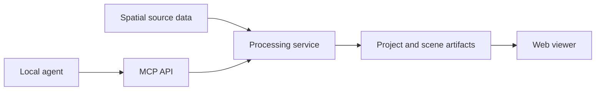

<h1 align="center">Companion Atlas</h1>

<p align="center"><strong>Companion Atlas 3D XR Globe to review and plan your travels.</strong></p>

[](https://github.com/companionintelligence/CI-Spatial-Atlas/releases)
[](https://github.com/companionintelligence/CI-Spatial-Atlas)
[](LICENSE.md)
[](https://discord.com/invite/yQp9hwpzAa)

<p align="center"><a href="#documentation">Documentation</a> · <a href="#license">License</a> · <a href="https://docs.ci.computer/docs/reference/open-source-systems">Systems map</a></p>

<p align="center">
  <a href="#quickstart-local-viewer"></a>
</p>

*(formerly Companion Earth; the GitHub repository was renamed from `CI-Earth`
to `Companion-Atlas`, and is now [`CI-Spatial-Atlas`](https://github.com/companionintelligence/CI-Spatial-Atlas))*

**Turn any image, set of images, or video into a shareable 4D (3D + time)
scrapbook map.** Companion Atlas is a containerized 3D processing server + web
viewer, built manually or automatically through an **MCP API**, and wired into
the Companion Intelligence suite (CI‑Server memory, OpenClaw, Hermes,
Companion OIDC).

| | |
|---|---|
| **License** | [PolyForm Noncommercial License 1.0.0](LICENSE.md) — free for noncommercial use, including personal, research, and nonprofit; see [§ License](#license) |
| **Status** | Active reimagining — see [`REIMAGINE.md`](REIMAGINE.md) for the roadmap |
| **Stack** | TypeScript · React + **Resium/CesiumJS** (desktop + mobile) · React-Three-Fiber + `@react-three/xr` (WebXR) · Fastify + MCP SDK (server) · Docker Compose |

## Documentation

| Doc | What's in it |
|---|---|
| [`REIMAGINE.md`](REIMAGINE.md) | **Start here.** Vision, the open-web-GIS-viewer research behind choosing CesiumJS (now live — see [`docs/architecture.md` §3](docs/architecture.md#3-renderer-selection)), the 4D `Story` data model, architecture, migration roadmap |
| [`docs/adr/0001-resium-viewer-r3f-xr.md`](docs/adr/0001-resium-viewer-r3f-xr.md) | Why one viewer: Resium/Cesium for desktop + mobile, R3F for WebXR |
| [`docs/architecture.md`](docs/architecture.md) | Mermaid diagrams of the system and the viewer module map, renderer selection, the `Story` schema, and the processing server, plus reference tables and the known gaps |
| [`docs/mcp-api.md`](docs/mcp-api.md) | The MCP tool reference for creating and publishing stories, manually or by an agent |
| [`viewer-react/mobile/README.md`](viewer-react/mobile/README.md) | The Capacitor iOS + Android shell: build commands, build-time configuration, how the native projects differ from a stock `cap add`, and what a store submission still needs |
| [`server/README.md`](server/README.md) | Running and extending the processing server, and the [Cloudflare Worker deployment](server/README.md#cloudflare-deployment-prod) at atlas.ci.computer |
| [`CHANGELOG.md`](CHANGELOG.md) | Notable changes by version |

## How it fits together

```
media / memory ─▶ ingest ─▶ reconstruct (SfM → mesh | gaussian splat) ─▶ 3D Tiles
   MCP / REST  ─▶ Atlas API ─▶ Story (4D doc) ─▶ publish ─▶ share URL ─▶ Viewer
```

- **Viewer** (`viewer-react/`, this app) — renders a `Story` on a Resium/Cesium
  globe, or the same `Story` in a headset via React-Three-Fiber. `npm run dev`,
  then visit `http://127.0.0.1:4174`.
- **Processing server + MCP API** (`server/`) — see [`server/README.md`](server/README.md).
- **Containerized stack** — `docker compose up viewer atlas-api minio postgres redis`
  (add `--profile gpu up worker` for reconstruction). See [`docker-compose.yml`](docker-compose.yml).
- **4D Story schema** — [`packages/story-schema/`](packages/story-schema)
  (`@companion-atlas/story`, Zod source of truth → generated JSON Schema),
  mirrored in [`server/src/schema.ts`](server/src/schema.ts) (runtime).

## Feature set

| Feature | What it provides |
|---|---|
| **Shared Story model** | Render Story data as a Cesium globe or an XR scene. |
| **Multiple inputs** | Load a URL, local draft or Memory query. |
| **Processing status** | Separate shipped viewer from scaffolded API, worker, store and connectors. |


- **One viewer, two renderers, one model.** `rendererForDevice()` picks the
  Resium/Cesium globe on desktop and mobile, and the React-Three-Fiber +
  `@react-three/xr` globe on a headset (Cesium has no WebXR). Both read the
  same `Story` from `@companion-atlas/story`, so a feature is added once.
  Force either with `?renderer=cesium` or `?renderer=xr`.
- **Real Cesium ion imagery, terrain, and 3D buildings**, degrading
  independently — with no ion token the globe falls back to Cesium's bundled
  offline Natural Earth II raster rather than going blank.
- **Live Companion Memory integration** — point the viewer at a CI-Server with
  `?memory=<url>` (`&token=`) and it renders your located photos and videos as
  a 4D story, with people, places, weather, and Street View peeks.
- **Spatial scrapbook** — collect memories into a draft, let the Companion
  curate it, and save it back to memory as a shareable story.
- **Timeline playback** — scrub or play the journey in time order, with
  day/night lighting driven off the clock.
- **WebXR** — grab-to-rotate and squeeze-to-zoom locomotion, memory pins, a
  wrist menu, and Street View plates in the headset.
- Load any `companion.atlas/story@1` document via `?story=<url>` — legacy Atlas
  *and* CI-Earth-2 documents both normalize through `loadStory`.
- A containerized processing server (`server/`) exposing the same capability
  as an **MCP API** — `atlas_create_story`, `atlas_ingest_media`,
  `atlas_auto_compose`, `atlas_publish_story`, and more (see
  [`docs/mcp-api.md`](docs/mcp-api.md)).

## Quickstart — local viewer

```sh
npm install
npm run dev
```

Or under [Deno](https://deno.com) (2.9+; `deno.json` mirrors these as tasks,
resolving `npm run <script>` → `deno task <script>` for every package in the
repo — root, `server/`, `packages/story-schema/`, `viewer-react/`):

```sh
deno install
deno task dev
```

Visit `http://127.0.0.1:4174`. With no configuration the viewer renders a
bundled demo story on offline imagery, and says so. To go further, put these in
`.env` (see [`.env.default`](.env.default)):

| Variable | Gets you |
|---|---|
| `VITE_CESIUM_ION_TOKEN` | Real ion World Imagery, World Terrain, OSM Buildings — free from [ion.cesium.com](https://ion.cesium.com/) |
| `VITE_GOOGLE_MAPS_API_KEY` | Photorealistic 3D buildings and Street View peeks |
| `VITE_MAPBOX_TOKEN` | Sharper satellite basemap |
| `VITE_MEMORY_URL` / `VITE_MEMORY_TOKEN` | Your real located memories from CI-Server |

URL params override all of them per load: `?memory=<url>&token=<jwt>` for live
memory, `?story=<url>` for a published story, `?renderer=cesium|xr` to force a
renderer.

> **Note:** clone with `--recurse-submodules`, or run
> `git submodule update --init` afterwards. The design tokens come from
> [CI-Common](https://github.com/companionintelligence/CI-Common), pinned as a
> submodule at `third_party/ci-common` and wired in as an npm workspace, so
> `npm install` and `npm run build` both work with nothing else on the machine.
> `npm ci` does not work yet: the committed `package-lock.json` is behind the
> `server` workspace (it lacks `wrangler` and `@cloudflare/workers-types` and pins
> an older `hono`), which is why CI runs `npm install`.
> CI-Common is a private repository, so you need access to it.
>
> This used to resolve to a sibling `../ci-common` checkout outside the repo,
> which is why the viewer build and its Docker image could never complete from a
> clean clone. Refresh the pin with
> `git submodule update --remote third_party/ci-common` and commit the new SHA.

## Quickstart — processing server + MCP API

```sh
cd server
npm install
npm run dev          # REST + MCP-over-HTTP on :8787
# or, for a local agent:
npm run mcp:stdio
```

Or under Deno, from the repo root (`server/src` depends on the
`packages/story-schema` workspace package, so `deno install` needs to run
where the workspace is declared):

```sh
deno install
cd server && deno task dev
```

See [`server/README.md`](server/README.md) and [`docs/mcp-api.md`](docs/mcp-api.md).

## Quickstart — full containerized stack

```sh
docker compose up viewer atlas-api minio postgres redis
# add reconstruction (requires an NVIDIA GPU):
docker compose --profile gpu up worker
```

## Quickstart — iOS and Android apps

[`viewer-react/mobile/`](viewer-react/mobile) wraps the viewer's production build in a
[Capacitor](https://capacitorjs.com) shell (`com.companionintelligence.atlas`). There is
no separate mobile UI: the app ships `viewer-react/dist`. It is a standalone npm
project, not a root workspace, so the web install and the Docker image are unaffected.

```sh
npm install                  # repo root: the web app
cd viewer-react/mobile
npm install                  # Capacitor, own lockfile
npm run build                # web build, then `cap sync` into ios/ and android/
npm run open:ios             # Xcode  (or: npm run open:android)
```

Unsigned debug builds (Android APK, iOS Simulator `.app`) also run from the manual-dispatch
[`mobile-build.yml`](.github/workflows/mobile-build.yml) workflow. The `VITE_*` settings above
are baked in when the web bundle is built (there is no `?memory=` inside the app).
The shell is a working, unsigned build; icons, signing, and privacy/store answers are
still open — see [`viewer-react/mobile/README.md`](viewer-react/mobile/README.md).

## Install as a web app (PWA)

The viewer installs as an app with no store review: serve it over HTTPS (or `localhost`) and
use the browser's install button. It has been checked in desktop Chrome only (with a
phone-sized window); other Chromium-based browsers should offer install too, but Edge, Quest
Browser, real Android devices and iOS (Add to Home Screen) have not been tried. An installed
copy opens in its own window with the canon dark background (`#041620`) behind the globe.
Browsers offer service workers and installation only on a secure origin, so a plain-`http` LAN
address stays an ordinary web page; put the appliance behind the Hub's Traefik TLS or a tailnet
certificate first.

| File | What it is |
|---|---|
| `viewer-react/public/manifest.webmanifest` | name, `display: standalone`, `#041620`, 192 / 512 / maskable icons |
| `viewer-react/public/icons/` | copied byte for byte from `@companionintelligence/assets` 1.5.1 (`icons/png/icon-192.png`, `icon-512.png`, `icon-maskable-512.png`, `apple-touch-icon-180.png`) |
| `viewer-react/public/sw.js` | the service worker |
| `viewer-react/public/offline/` | the page it shows when a page load cannot reach the network, served at `/offline/` (a folder, not `offline.html`: Cloudflare answers a `.html` URL with a redirect, which a navigation cannot use) |
| `viewer-react/src/pwa/registerServiceWorker.ts` | registers it from the bundle in production builds; skipped in the Capacitor shells and inside iframes |

The worker is deliberately small. It never caches the app, Cesium, imagery, stories or
anything from a Memory server or the API, and it never writes to a cache after install: all of
that goes straight to the network. Its one job is to show `/offline/` when a page load cannot
reach the network.

To retire it:

1. Copy [`docs/service-worker-kill-switch.js`](docs/service-worker-kill-switch.js) over
   `viewer-react/public/sw.js`. It has no fetch handler; when a browser installs it, it deletes
   the `ci-atlas-offline-*` caches and unregisters itself.
2. Delete the `registerServiceWorker()` call, and its import, from `viewer-react/src/main.tsx`.
3. Deploy, and leave it deployed for weeks: a browser replaces its worker on a later visit.

A plain revert is not enough: with `/sw.js` gone, a browser's update check gets a 404, the update
fails, and the old worker stays installed. No test has to be deleted and nothing else has to
change. The kill switch's first line, `// atlas:service-worker-kill-switch`, is a marker: while
`viewer-react/public/sw.js` starts with it, `npm run build` (so the image build and the deploy
workflow too) and the unit tests stop requiring the offline page, the precache list, the cache
fingerprint and the registration in the bundle.

**An installed Atlas starts at `/`, so it loses the URL parameters.** The manifest's
`start_url` and `scope` are `/`, so every launch from the home screen or the app list opens
the site root and drops `?memory=`, `?token=`, `?apiKey=` and `?story=`. The viewer reads
those from the URL on every load (`viewer-react/src/story/useStory.ts`), and CI-Hub wires a
per-install Companion Memory server into this static bundle through exactly those parameters
(see the note in `hub/docker-compose.json`). The image is built with an empty `VITE_MEMORY_URL`
by default, so an Atlas installed from a Hub install opens on the labelled demo story. To have
an installed copy open on a Memory server, build the bundle with `VITE_MEMORY_URL` set (a build
argument in `viewer-react/Dockerfile`). Remembering the Memory URL between launches (never the
token) is the obvious remedy, but it is a product decision that has not been made, and it is
not part of this change.

The container image's nginx config (`viewer-react/Dockerfile`) has two exact-match locations
ahead of the SPA fallback: `/sw.js` is sent with `Cache-Control: no-cache`, so a shared cache
revalidates it instead of serving a stale copy, and `/manifest.webmanifest` is sent as
`application/manifest+json`, a type stock nginx has no mapping for.

To check installability against a production build, run `npm run build` and
`npm run preview -w viewer-react`, then open DevTools → Application → Manifest, or call
`Page.getInstallabilityErrors` over the Chrome DevTools Protocol.

## Developing the viewer

```sh
npm run dev        # schema package + viewer dev server on :4174
npm test           # Vitest across viewer-react, server, and the schema package
npm run build      # tsc --noEmit && vite build
```

`npm test` is the fast gate; `npm run build` is the pre-merge one. See
[`WORKFLOW.md`](WORKFLOW.md).

There is no pixel-diff visual regression suite today — the old one covered the
removed vanilla-TS viewer's deterministic `?static=1` path, and establishing
baselines against Resium is open work (see
[`docs/CONSOLIDATION.md`](docs/CONSOLIDATION.md)).
`viewer-react/tests/*.capture.ts` are Playwright *capture* scripts for docs and
review, not assertions:

```sh
npx playwright install chromium
npx playwright test --config=viewer-react/playwright.capture.config.js
```

## New account session

A local namespace key for scoping scrapbook pins — **not** an authentication
system (Companion OIDC, once wired into the viewer, will replace this; see
[`REIMAGINE.md`](REIMAGINE.md)).

- CLI setup: `npm run account:new -- "my-account"`

## Agent customization files

- `.github/copilot-instructions.md`
- `.github/instructions/vibe-loop.instructions.md`
- `.github/agents/vibe-iteration.agent.md`
- `.github/prompts/vibe-iterate.prompt.md`

These files are configured to support continuous, scoped iterations gated on
`npm test` and `npm run build`.

`.claude/hooks/session-start.sh` is Claude Code on the web's equivalent: a
SessionStart hook that inits the private `third_party/ci-common` submodule
and runs `npm install` so a cloud session is immediately buildable/testable,
given a `NODE_AUTH_TOKEN` (GitHub PAT, `read:packages` on
`companionintelligence`) configured in the environment's settings.

<!-- companion-hub-readme-deep-review -->

## Processing and deployment requirements

| Mode | Services | Additional requirement |
|---|---|---|
| Local viewer | Web viewer and its configured API | Browser with WebGL support |
| Processing + MCP | Processing service and MCP API | Local agent configured to the MCP endpoint |
| Reconstruction | Full stack plus reconstruction worker | NVIDIA GPU and compatible container GPU access |



Use the repository's [documentation index](docs/README.md) for the viewer, processing server, MCP API, and reconstruction-specific setup. Reconstruction is an optional path and requires GPU access; the viewer-only path does not.

## License

Companion Atlas uses the [PolyForm Noncommercial License 1.0.0](https://polyformproject.org/licenses/noncommercial/1.0.0)
— free to run, fork, and modify for personal, research, and other noncommercial
use. Companion Atlas is a free, public Companion Intelligence app. See
[`LICENSE.md`](LICENSE.md) and [`docs/License-FAQ.md`](docs/License-FAQ.md) for
the specifics. The underlying research in [`REIMAGINE.md`](REIMAGINE.md) surveys
open-source tools (CesiumJS, COLMAP, OpenDroneMap, Nerfstudio, etc.) that
Companion Atlas integrates with or is inspired by — those third-party projects
retain their own licenses.

For licensing inquiries or support: [support documentation](https://docs.ci.computer/docs/troubleshooting/getting-help)
or **team@ci.computer**.
