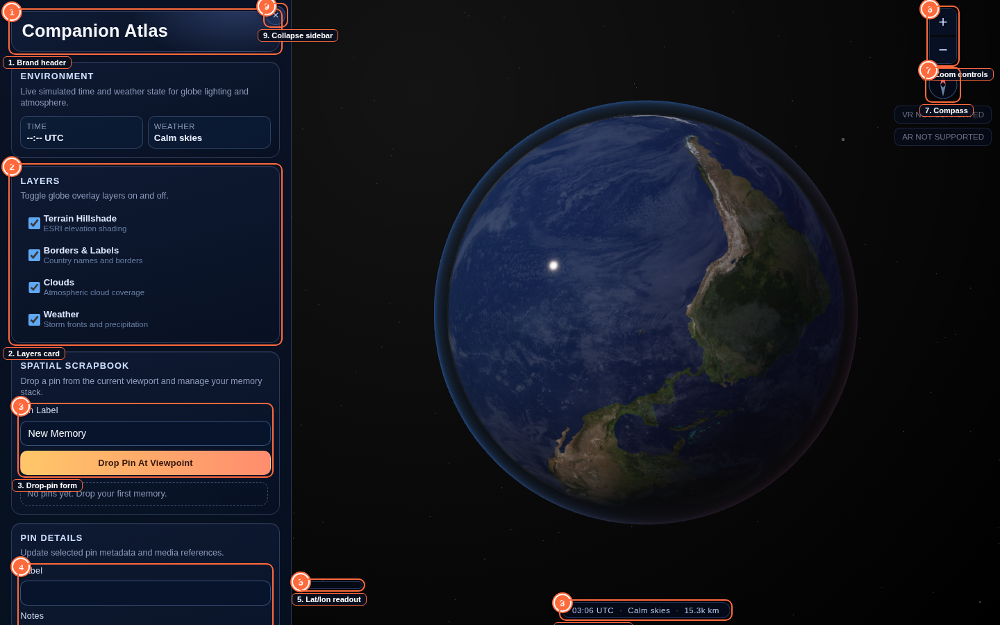
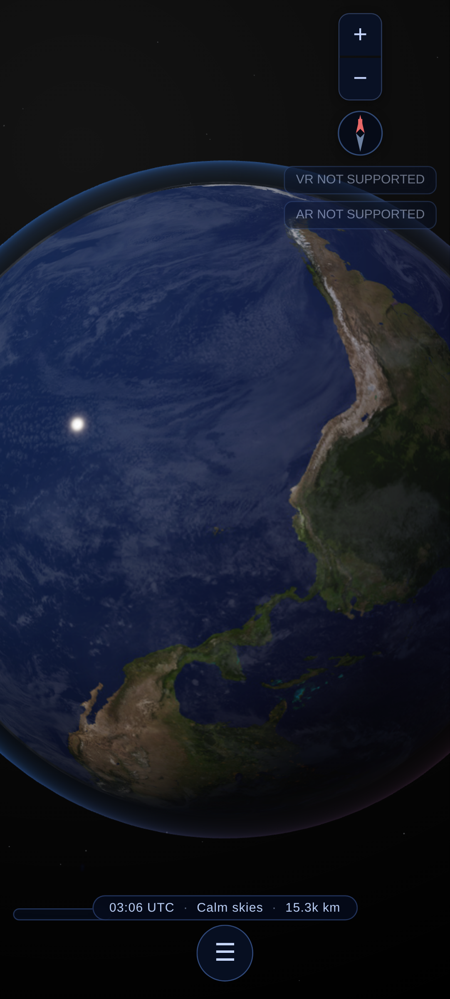
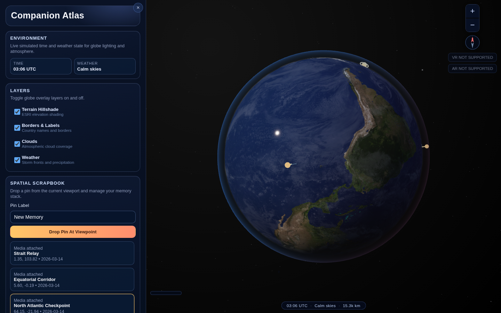

# Companion Atlas

*(formerly Companion Earth; the GitHub repository was renamed from `CI-Earth`
to [`Companion-Atlas`](https://github.com/companionintelligence/Companion-Atlas))*

**Turn any image, set of images, or video into a shareable 4D (3D + time)
scrapbook map.** Companion Atlas is a containerized 3D processing server + web
viewer, built manually or automatically through an **MCP API**, and wired into
the Companion Intelligence suite (CI‑Server memory, OpenClaw, Hermes,
Companion OIDC).



| | |
|---|---|
| **License** | [Commercial Standard License](LICENSE.md) — proprietary, not open source (see [§ License](#license)) |
| **Status** | Active reimagining — see [`REIMAGINE.md`](REIMAGINE.md) for the roadmap |
| **Stack** | TypeScript · three.js (viewer) · Fastify + MCP SDK (server) · Docker Compose |

## Documentation

| Doc | What's in it |
|---|---|
| [`REIMAGINE.md`](REIMAGINE.md) | **Start here.** Vision, the open-web-GIS-viewer research and recommendation (→ CesiumJS), the 4D `Story` data model, architecture, migration roadmap |
| [`docs/ui-guide.md`](docs/ui-guide.md) | Every screen, panel, and button in the viewer, with screenshots and interaction tables |
| [`docs/architecture.md`](docs/architecture.md) | Mermaid diagrams of the system, render loop, camera model, pin lifecycle, texture pipeline, the `Story` schema, and the processing server, plus reference tables |
| [`docs/mcp-api.md`](docs/mcp-api.md) | The MCP tool reference for creating and publishing stories, manually or by an agent |
| [`server/README.md`](server/README.md) | Running and extending the processing server |
| [`CHANGELOG.md`](CHANGELOG.md) | Notable changes by version |

## How it fits together

```
media / memory ─▶ ingest ─▶ reconstruct (SfM → mesh | gaussian splat) ─▶ 3D Tiles
   MCP / REST  ─▶ Atlas API ─▶ Story (4D doc) ─▶ publish ─▶ share URL ─▶ Viewer
```

- **Viewer** (`src/`, this app) — renders a published `Story`. Open one today on
  the existing globe: `npm run vibe:dev` then visit
  `/?imagery=local&story=/stories/sample-pacific-journey.json`.
- **Processing server + MCP API** (`server/`) — see [`server/README.md`](server/README.md).
- **Containerized stack** — `docker compose up viewer atlas-api minio postgres redis`
  (add `--profile gpu up worker` for reconstruction). See [`docker-compose.yml`](docker-compose.yml).
- **4D Story schema** — [`src/atlas/schema.ts`](src/atlas/schema.ts) (viewer types),
  mirrored in [`server/src/schema.ts`](server/src/schema.ts) (runtime).

## Feature set

- Declarative three.js scene: procedural + KTX2-backed Earth, sky, cloud, and night-lights rendering
- Live imagery layers (terrain hillshade, borders/labels, clouds, weather) with per-layer toggles
- Desktop drag-to-orbit, right-drag tilt, wheel/pinch zoom, double-click zoom-in
- WebXR entry (VR grab-to-rotate, squeeze-to-zoom; AR passthrough)
- Optional Google/Cesium 3D Tiles streaming (`src/systems/tilesSystem.ts`)
- Spatial scrapbook: drop pins from the current viewpoint, edit metadata, fly to a pin, delete
- Chronological journey playback across pins, with an auto-drawn route curve
- Account-scoped local persistence for scrapbook memories
- **New:** load any [`companion.atlas/story@1`](src/atlas/schema.ts) document via `?story=<url>` — a preview of the shareable 4D format ahead of the CesiumJS viewer
- **New:** a containerized processing server (`server/`) exposing the same capability as an **MCP API** — `atlas_create_story`, `atlas_ingest_media`, `atlas_auto_compose`, `atlas_publish_story`, and more (see [`docs/mcp-api.md`](docs/mcp-api.md))
- Deterministic visual regression mode via `/?static=1`

## Quickstart — local viewer

```sh
npm install
npm run textures:build
npm run vibe:dev
```

Visit `http://127.0.0.1:4173`. Force a specific imagery mode with
`?imagery=local` or `?imagery=live`, or load a sample 4D story with
`?story=/stories/sample-pacific-journey.json`.

## Quickstart — processing server + MCP API

```sh
cd server
npm install
npm run dev          # REST + MCP-over-HTTP on :8787
# or, for a local agent:
npm run mcp:stdio
```

See [`server/README.md`](server/README.md) and [`docs/mcp-api.md`](docs/mcp-api.md).

## Quickstart — full containerized stack

```sh
docker compose up viewer atlas-api minio postgres redis
# add reconstruction (requires an NVIDIA GPU):
docker compose --profile gpu up worker
```

## More screenshots

| | |
|---|---|
|  |  |

See [`docs/ui-guide.md`](docs/ui-guide.md) for the full annotated set — every
card, HUD element, and interaction state.

## Iterative vibe loop (viewer development)

1. `npm install`
2. `npm run textures:build`
3. `npm run vibe:dev`
4. `npm run vibe:build`
5. `npm run vibe:test`
6. If UI changes are intentional: `npm run vibe:test:update` then `npm run vibe:test`
7. Pre-merge gate: `npm run vibe:loop`

Deterministic screenshot testing uses `/?static=1` to disable animation drift
(see [`docs/architecture.md` §3](docs/architecture.md#3-render-loop)). After a
UI change, also regenerate the documentation screenshots:

```sh
npm run docs:screenshots   # dev server must already be running
```

## Texture assets

- Source masters live in [materials](materials).
- Derived runtime files are generated into [public/textures](public/textures) and [public/basis](public/basis).
- Regenerate the texture set with `npm run textures:build`.
- Static mode defaults to local textured rendering: `/?static=1`.
- Force local textured rendering in normal browsing with `/?imagery=local`.
- Force live provider imagery with `/?imagery=live`.

## New account session

A local namespace key for scoping scrapbook pins — **not** an authentication
system (Companion OIDC, once wired into the viewer, will replace this; see
[`REIMAGINE.md`](REIMAGINE.md)).

- CLI setup: `npm run account:new -- "my-account"`
- In-app setup: use the **Account Settings** panel and submit.

## Agent customization files

- `.github/copilot-instructions.md`
- `.github/instructions/vibe-loop.instructions.md`
- `.github/agents/vibe-iteration.agent.md`
- `.github/prompts/vibe-iterate.prompt.md`

These files are configured to support continuous, scoped iterations with visual stability checks.

## License

Companion Atlas is proprietary software distributed under the **Commercial
Standard License** (`CI-Commercial-1.0`) — see [`LICENSE.md`](LICENSE.md). It
is **not** open source: the license does not grant rights to copy, redistribute,
sublicense, or incorporate this software into other products without the
licensor's prior written consent, and no source code rights are implied by
having read access to this repository. The underlying research in
[`REIMAGINE.md`](REIMAGINE.md) surveys open-source tools (CesiumJS, COLMAP,
OpenDroneMap, Nerfstudio, etc.) that Companion Atlas integrates with or is
inspired by — those third-party projects retain their own licenses.

For licensing inquiries or support: [ci.computer/support-faqs](https://ci.computer/support-faqs)
or **team@ci.computer**.
