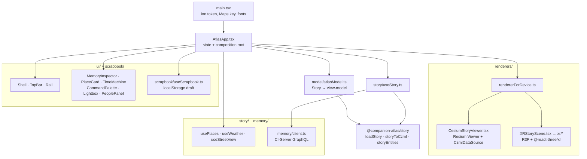
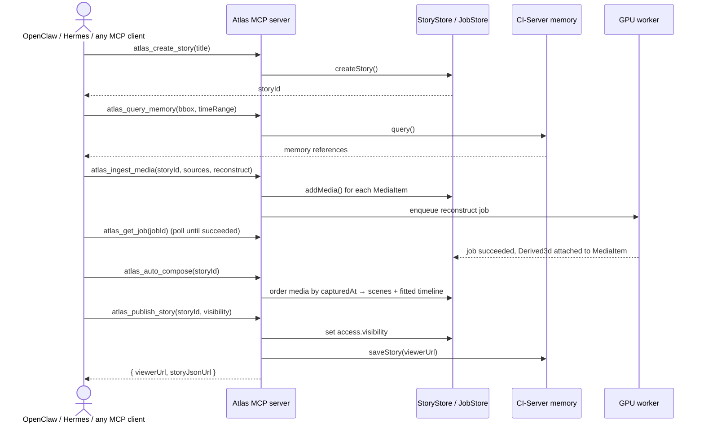

# Architecture — How Companion Atlas Works

Technical reference for the viewer, the processing server, and how the two fit
into the wider Companion Intelligence suite. Pairs with
[`docs/mcp-api.md`](mcp-api.md) (the full MCP tool reference) and
[`docs/REDESIGN.md`](REDESIGN.md) (what the viewer's UI is trying to be). For
the product direction and open-web-GIS research behind these decisions, see
[`REIMAGINE.md`](../REIMAGINE.md); for why there is one viewer rather than two,
see [`docs/adr/0001-resium-viewer-r3f-xr.md`](adr/0001-resium-viewer-r3f-xr.md).

## 1. System overview

```mermaid
flowchart LR
    subgraph Suite["Companion Intelligence suite"]
        Memory[("CI-Server memory")]
        OpenClaw["OpenClaw"]
        Hermes["Hermes"]
        OIDC["Companion OIDC"]
    end

    subgraph Atlas["Companion Atlas"]
        Viewer["Web viewer<br/>(Resium/Cesium + R3F WebXR)"]
        API["atlas-api<br/>REST + MCP server"]
        Worker["GPU reconstruction worker<br/>COLMAP / ODM / Nerfstudio"]
        Store[("Postgres + Redis + MinIO")]
    end

    Memory <-- "query / save story" --> API
    Memory <-- "located search()" --> Viewer
    OpenClaw -- "MCP tool calls" --> API
    API -- "publish notify" --> Hermes
    OIDC -. "bearer auth" .-> API
    API <--> Store
    API -- "enqueue job" --> Worker
    Worker -- "3D Tiles / splats" --> Store
    Viewer -- "fetch Story JSON" --> API
    API -- "share URL" --> Viewer
```



Today's repo ships the **Viewer** (`viewer-react/`, two renderers over one
model — see [§2](#2-viewer-module-map) and [§3](#3-renderer-selection)) and the
**atlas-api** scaffold (`server/`) — see
[`docker-compose.yml`](../docker-compose.yml) for how the pieces run together
in containers. `Worker`, `Store`, and the suite connectors are functional
scaffolds (see [§6](#6-processing-server)); the viewer's `?story=` and
`?memory=` modes ([§4](#4-where-the-story-comes-from)) let you exercise the
`Story` format end to end without any of that infrastructure running.

## 2. Viewer module map

The viewer is a React SPA. Everything downstream of `@companion-atlas/story`
reads the *same* `Story`, so a feature is added once and both renderers get it.



| Module | Owns |
|---|---|
| `src/main.tsx` | Bootstraps: `Cesium.Ion.defaultAccessToken`, Maps key, Manrope, mounts `AtlasApp` |
| `src/AtlasApp.tsx` | Composition root — story state, selection, playback, panel wiring |
| `src/story/useStory.ts` | Resolves the `Story` from Memory, a published URL, or the bundled sample |
| `src/model/atlasModel.ts` | `Story` → the view-model the UI renders (`AtlasMemory`, place summaries, time-of-day) |
| `src/memory/client.ts` | CI-Server GraphQL: located `search()` in, `createEvent` story write-back out |
| `src/renderers/CesiumStoryViewer.tsx` | Resium `<Viewer>` + `<CzmlDataSource>` from `storyToCzml`, one `<Cesium3DTileset>` per tileset |
| `src/renderers/xr/` | The WebXR globe: locomotion, sky shell, memory pins, wrist menu, Street View plates |
| `src/ui/` | Shell, rail, inspector, place card, time machine, command palette, lightbox |
| `src/scrapbook/useScrapbook.ts` | The local scrapbook draft (`localStorage`, account-scoped) |
| `src/theme/` | `@companionintelligence/tokens` + the Atlas surface CSS |

## 3. Renderer selection

`rendererForDevice()` (`src/renderers/rendererForDevice.ts`) picks one of two
renderers over the same `Story`:

| Result | When | What renders |
|---|---|---|
| `xr` | `navigator.xr.isSessionSupported('immersive-vr')` resolves true | `XRStoryScene` — R3F + `@react-three/xr` globe (Cesium has no WebXR support) |
| `cesium` | everything else, and on any XR probe failure | `CesiumStoryViewer` — Resium/Cesium globe |

`?renderer=cesium|xr` forces either one, which is how you drive the XR path
from a desktop browser (with `iwer` emulating a headset in dev).

Imagery degrades independently of all this: with no `VITE_CESIUM_ION_TOKEN`
the globe falls back to Cesium's bundled offline Natural Earth II raster rather
than rendering an unpickable black sphere. `VITE_MAPBOX_TOKEN` and
`VITE_GOOGLE_MAPS_API_KEY` add sharper basemaps, 3D buildings, and Street View
peeks when present (`src/renderers/basemaps.ts`).

## 4. Where the `Story` comes from

`useStory()` resolves exactly one 4D unit to render, in priority order:

| Source | Trigger | Notes |
|---|---|---|
| **Companion Memory** | `?memory=<ci-server-url>` (+ `&token=`), or `VITE_MEMORY_URL` / `VITE_MEMORY_TOKEN` | Real data. Queries CI-Server's located `search()` and maps it with `mediaItemsFromMemory` |
| **A published story** | `?story=<url>` | Accepts legacy Atlas *and* CI-Earth-2 documents via `loadStory` |
| **The bundled sample** | nothing configured | So the viewer renders out of the box. The UI marks it "Demo data — not connected" — synthetic places rendered unmarked read as a fake product rather than a disconnected one |

URL params override env vars at runtime, so one built image can point at
different Companion Memory servers per page load.

## 5. The 4D `Story` data model


Defined once as Zod in
[`packages/story-schema/src/`](../packages/story-schema/src) — the canonical
`@companion-atlas/story` package, which generates the JSON Schema
(`npm run gen:schema -w @companion-atlas/story`) and ships the normalizers
(`loadStory` reads legacy Atlas *and* CI-Earth-2 documents), the CZML converter
(`storyToCzml`), and `mediaItemsFromMemory`. The server mirrors it at runtime in
[`server/src/schema.ts`](../server/src/schema.ts). The viewer projects a `Story`
into its own view-model in
[`viewer-react/src/model/atlasModel.ts`](../viewer-react/src/model/atlasModel.ts)
(see [§2](#2-viewer-module-map)).

<a id="processing-server"></a>
## 6. Processing server

`server/` (package `@companion/atlas-server`) is the **3D processing server +
MCP API**. Full MCP tool reference: [`docs/mcp-api.md`](mcp-api.md). This
section covers the pieces mcp-api.md doesn't: the REST surface, the
ingest→reconstruct→tile pipeline, and the suite connectors.

### 6.1 Auto-compose flow (the "automatic" path)



### 6.2 Image/video → 3D pipeline (`server/src/pipeline.ts`)



```mermaid
flowchart LR
    Sources["images / image-set / video<br/>(object-store URLs or ci-memory://)"] --> Ingest
    subgraph Ingest["1. ingest()"]
        direction TB
        Exif["exiftool -json → GPS + capture time"]
        Frames["ffmpeg frame sampling + GPMF/telemetry tracks"]
    end
    Ingest --> MediaItems["MediaItem[]"]
    MediaItems --> Reconstruct
    subgraph Reconstruct["2. reconstruct()"]
        direction TB
        Photo["photogrammetry: COLMAP → OpenMVS / OpenDroneMap"]
        Splat["gaussian-splat: COLMAP poses → Nerfstudio / gsplat"]
    end
    Reconstruct --> Tile
    subgraph Tile["3. tile()"]
        direction TB
        MeshTiles["meshes → py3dtiles / 3d-tiles-tools"]
        SplatTiles["splats → SplatTransform/SOGS → KHR_gaussian_splatting 3D Tiles"]
    end
    Tile --> Derived3d["Derived3d attached to MediaItem<br/>(kind, uri, job)"]
```

Stages 2–3 run in the GPU worker container
([`docker/Dockerfile.worker`](../docker/Dockerfile.worker)); `server/src/pipeline.ts`
only orchestrates — the heavy native tools are not npm dependencies.

### 6.3 REST endpoints (`server/src/api.ts`)

`GET /healthz` and `GET /api/public/stories/:id` are unauthenticated — the
latter is what lets the viewer load a shared story from a `?story=` URL. The
two list/fetch routes below are reachable without a token but return only what
`canRead` allows. **Every mutating route requires a verified subject** (401
otherwise) **and is scoped to the story's owner** (403 otherwise); see
[`server/src/auth.ts`](../server/src/auth.ts). With `COMPANION_OIDC_ISSUER`
unset, every request instead runs as a single `*`-scoped dev subject — local
development only, and currently unguarded (see
[§13](#13-known-gaps--deliberately-out-of-scope-today)).

| Method | Path | Purpose |
|---|---|---|
| `GET` | `/healthz` | Liveness check |
| `GET` | `/api/public/stories/:id` | **Public** — the story JSON the viewer's `?story=` loader fetches |
| `GET` | `/api/stories` | List stories visible to the caller (`canRead`-filtered) |
| `POST` | `/api/stories` | Create a story — **auth required**; the verified subject becomes the owner |
| `GET` | `/api/stories/:id` | Fetch a story (`canRead`) |
| `DELETE` | `/api/stories/:id` | Delete a story — **auth + owner** |
| `POST` | `/api/stories/:id/media` | Ingest media (+ optional `reconstruct` job) — **auth + owner** |
| `POST` | `/api/stories/:id/scenes` | Append a scene — **auth + owner** |
| `POST` | `/api/stories/:id/compose` | Auto-sequence located media into scenes — **auth + owner** |
| `POST` | `/api/stories/:id/publish` | Set visibility, write back to memory, notify OpenClaw/Hermes — **auth + owner**; does not transfer ownership |
| `GET` | `/api/jobs/:id` | Poll an ingest/reconstruct/tile job — **auth**, scoped to its story's readers |
| `POST` | `/mcp` | MCP over Streamable HTTP (stateless — one server+transport per request, built with that request's `AuthContext`, so tools are scoped to the caller) |

### 6.4 Suite connectors (`server/src/connectors.ts`)

| Connector | Env var | Role |
|---|---|---|
| `CiMemoryConnector` | `CI_MEMORY_URL` | Seeds stories from geotagged memories (`query`), resolves `ci-memory://` refs, writes finished stories back (`saveStory`) |
| `OpenClawConnector` | `OPENCLAW_URL` | Notified when a story publishes (`notifyStoryReady`) |
| `HermesConnector` | `HERMES_URL` | Delivers a published story link to a channel/recipient (`deliver`) |

All three are unconditional stubs today regardless of configuration (see
[§8](#8-known-gaps--deliberately-out-of-scope-today)) — the server runs
standalone without the rest of the suite either way.

## 7. Reference tables

### 7.1 npm scripts — root (`package.json`)

| Script | Command | Purpose |
|---|---|---|
| `dev` | schema build, then `vite` in `viewer-react` | Dev server on `127.0.0.1:4174` |
| `build` | schema build, then `tsc --noEmit && vite build` | Typecheck + production bundle |
| `preview` | `vite preview` in `viewer-react` | Serve the production build locally |
| `test` | Vitest in `viewer-react` + `server` | The fast gate |
| `typecheck` | schema build, then `tsc --noEmit` in `server` | Type-only check |
| `lint:canon` | `node scripts/lint-canon.mjs .` | Canon/naming lint |
| `account:new` | `tsx scripts/new-account.ts` | Write a local `.companion-atlas-account.json` |

Every script has a `deno task` twin in [`deno.json`](../deno.json).
`packages/story-schema` must be built before anything that imports
`@companion-atlas/story` typechecks — that is why each root script does it
first.

### 7.2 npm scripts — server (`server/package.json`)

| Script | Command | Purpose |
|---|---|---|
| `dev` | `tsx watch src/index.ts` | REST API + MCP-over-HTTP on `:8787`, hot-reloading |
| `mcp:stdio` | `tsx src/mcp-stdio.ts` | MCP server over stdio, for local agents |
| `build` | `tsc -p tsconfig.json` | Compile to `dist/` |
| `start` | `node dist/index.js` | Run the compiled server |
| `typecheck` | `tsc -p tsconfig.json --noEmit` | Type-only check |

### 7.3 Environment variables (`.env.default`)

| Group | Variables |
|---|---|
| Viewer (build-time, Vite-inlined) | `VITE_CESIUM_ION_TOKEN`, `VITE_GOOGLE_MAPS_API_KEY`, `VITE_MAPBOX_TOKEN`, `VITE_MEMORY_URL`, `VITE_MEMORY_TOKEN` |
| Viewer SPA login (`.env.dev.example`) | `VITE_OIDC_ISSUER`, `VITE_OIDC_CLIENT_ID`, `VITE_OIDC_REDIRECT_URI`, `VITE_ATLAS_API` |
| Atlas server URLs | `ATLAS_VIEWER_BASE_URL`, `ATLAS_API_BASE_URL` |
| Infrastructure | `DATABASE_URL`, `REDIS_URL`, `S3_ENDPOINT`, `S3_BUCKET` |
| Suite connectors | `CI_MEMORY_URL`, `OPENCLAW_URL`, `HERMES_URL` |
| Companion OIDC | `COMPANION_OIDC_ISSUER`, `COMPANION_OIDC_AUDIENCE`, `COMPANION_OIDC_CLIENT_ID`, `COMPANION_OIDC_CLIENT_SECRET`, `ATLAS_DEV_SUBJECT` |

Every `VITE_*` value is inlined into the bundle at build time and is therefore
**public**. `VITE_MEMORY_TOKEN` in particular is a build-time default for
single-tenant deployments only; multi-user installs pass `?token=` per session
instead.

### 7.4 Docker Compose services (`docker-compose.yml`)

| Service | Image / build | Purpose | Profile |
|---|---|---|---|
| `viewer` | `viewer-react/Dockerfile` (nginx, `:8080`) | The web viewer | default |
| `atlas-api` | `server/Dockerfile` | REST + MCP server | default |
| `worker` | `docker/Dockerfile.worker` (CUDA) | GPU reconstruction | `gpu` |
| `minio` | `minio/minio` | S3-compatible object store | default |
| `postgres` | `postgres:16-alpine` | Story/scene/media metadata | default |
| `redis` | `redis:7-alpine` | Job queue | default |

```sh
docker compose up viewer atlas-api minio postgres redis   # app tier
docker compose --profile gpu up worker                     # + reconstruction
```

[`docker-compose.dev.yml`](../docker-compose.dev.yml) is the local variant: the
stores and API in containers, the viewer on the host for HMR.

## 8. Known gaps / deliberately out of scope today

- **The viewer cannot be built in CI or in Docker.**
  `viewer-react/src/theme/index.ts` imports `@companionintelligence/tokens`,
  which `package-lock.json` resolves to `link:../ci-common/packages/tokens` — a
  sibling checkout of CI-Common, outside this repository. Vitest suites don't
  touch that import so they run fine, but `npm run build`,
  `viewer-react/Dockerfile`, and any GHCR publish all need that package
  resolvable. `viewer-react/.npmrc` already points `@companionintelligence` at
  GitHub Packages; publishing the package there (and giving CI a
  `NODE_AUTH_TOKEN`) is what closes this. Until then
  [`hub/docker-compose.json`](../hub/docker-compose.json) names an image that
  nothing in this repo produces.
- **No pixel-diff visual regression.** The old suite covered the removed
  vanilla-TS viewer's deterministic `?static=1` path. Cesium/Resium has none —
  making it deterministic (offline imagery, ion disabled, locked camera and
  clock, masked dynamic regions, tolerant `maxDiffPixelRatio`) is open work
  from [`docs/CONSOLIDATION.md`](CONSOLIDATION.md). `viewer-react/tests/` holds
  Playwright *capture* scripts (video for docs/review), not assertions.
- **Auth: verification and authorisation are both real now; one gap remains.**
  `verifyBearer()` in [`server/src/auth.ts`](../server/src/auth.ts) does a real
  `jose.jwtVerify` against the issuer's JWKS, enforcing signature, issuer,
  audience, expiry and a usable `sub`. Authorisation is enforced on top of it:
  every mutating REST route and every MCP tool requires a verified subject
  (401 / "Unauthenticated" otherwise) and is scoped to the story's owner
  (`access.oidcSubject`) via `canWrite`, while reads stay open to
  public/unlisted stories via `canRead`. The dev bypass is now fenced off from
  deployments: `assertAuthSafeToBoot()` runs in
  [`server/src/index.ts`](../server/src/index.ts) before the port is bound and
  exits non-zero if `COMPANION_OIDC_ISSUER` is unset *and* the environment has
  not identified itself as non-deployed — `NODE_ENV=development`/`test`, or an
  explicit `ATLAS_ALLOW_DEV_AUTH=1`. The allowlist is deliberate: gating on
  `NODE_ENV === 'production'` alone would fail open on an unset `NODE_ENV`,
  which is the likeliest shape of the misconfiguration, so absence of proof is
  treated as deployed. The stdio MCP entry
  ([`server/src/mcp-stdio.ts`](../server/src/mcp-stdio.ts)) is exempt by design —
  there the local process is the trust boundary and the store is per-process.
  What is still outstanding:
  - **Portal scopes are parsed but not mapped.** `*` is the only scope
    honoured; ownership carries the model. Mapping CI-Portal's scope
    vocabulary onto Atlas operations is a deliberate follow-up — that
    vocabulary isn't defined anywhere Atlas can see yet, so a mapping written
    today would be invented rather than agreed.
- **Stores are in-memory.** `server/src/store.ts`'s `InMemoryStore` loses all
  data on restart — see [`REIMAGINE.md` Phase 1](../REIMAGINE.md#8-migration-roadmap)
  for the Postgres/Redis/MinIO migration.
- **The reconstruction pipeline is an orchestration stub.** `ingest()` and
  `reconstruct()` in `server/src/pipeline.ts` return well-typed placeholder
  results; they do not yet shell out to COLMAP/ODM/Nerfstudio. The Dockerfile
  for the worker installs the real toolchain in anticipation of this.
- **Suite connectors are unconditional stubs**, not just no-ops when
  unconfigured — every method on `CiMemoryConnector`, `OpenClawConnector`, and
  `HermesConnector` (`server/src/connectors.ts`) returns immediately with a
  `// TODO` comment regardless of whether its URL is set. Same category of gap
  as the reconstruction pipeline above.
