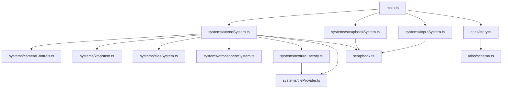
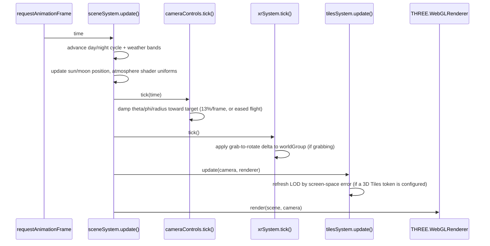
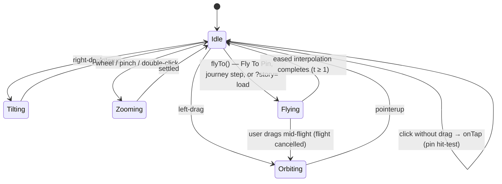
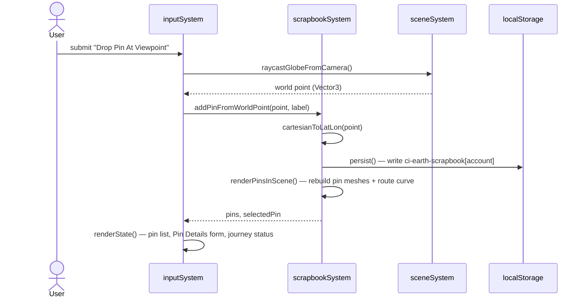
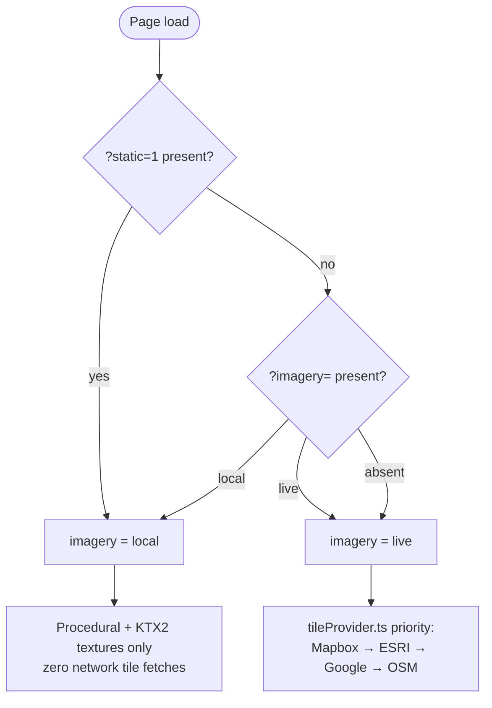
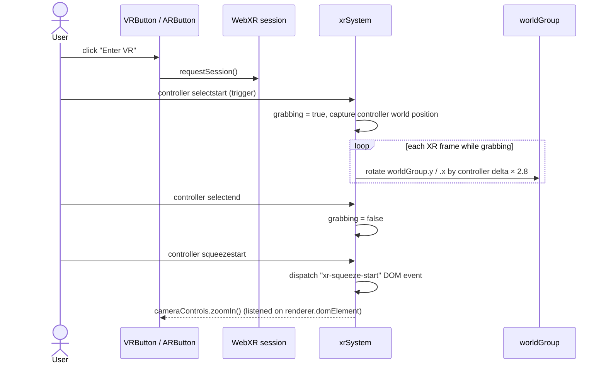
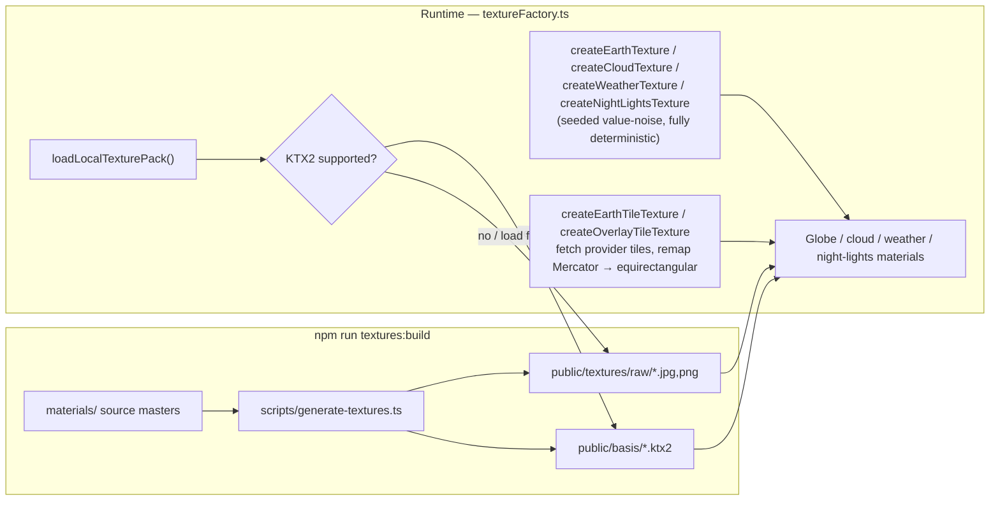
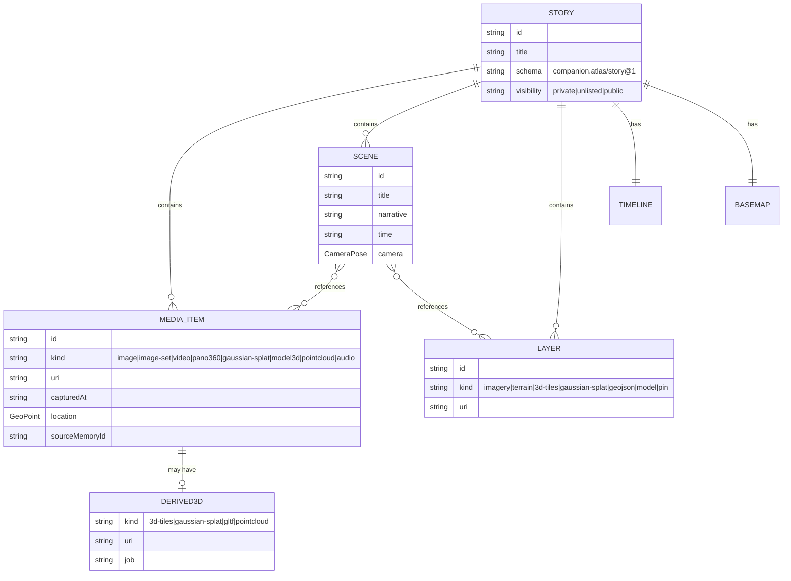
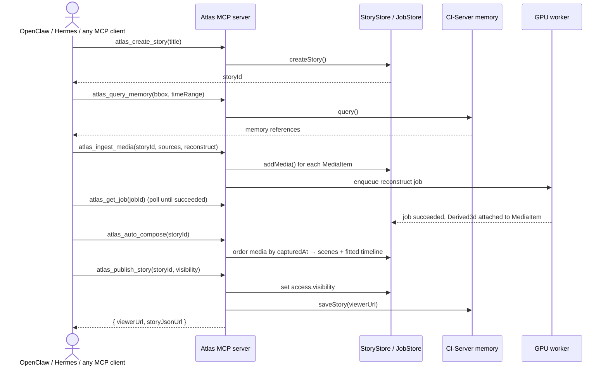

# Architecture — How Companion Atlas Works

Technical reference for the viewer, the processing server, and how the two
fit into the wider Companion Intelligence suite. Pairs with
[`docs/ui-guide.md`](ui-guide.md) (what you see) and
[`docs/mcp-api.md`](mcp-api.md) (the full MCP tool reference). For the product
direction and open-web-GIS research behind these decisions, see
[`REIMAGINE.md`](../REIMAGINE.md).

## 1. System overview


Today's repo ships the **Viewer** (this three.js app, `src/`) and the
**atlas-api** scaffold (`server/`) — see [`docker-compose.yml`](../docker-compose.yml)
for how all five pieces run together in containers. `Worker`, `Store`, and the
suite connectors are functional scaffolds (see [§10](#processing-server)); the
viewer's `?story=` mode (below) lets you exercise the `Story` format end to end
without any of that infrastructure running.

## 2. Viewer module map



`main.ts` is the composition root: it builds `sceneSystem` and
`scrapbookSystem`, wires DOM elements into `inputSystem`'s handler callbacks,
and owns the two `setInterval` loops (journey playback, 200ms HUD tick). No
module reaches back into `main.ts` — data flows down, callbacks flow up.

## 3. Render loop



Under `?static=1`, `startLoop()` calls `update()` **exactly once** instead of
registering `renderer.setAnimationLoop` — no day/night drift, no camera
damping beyond a single 13% step, which is what makes Playwright screenshots
reproducible.

## 4. Camera interaction model



`cameraControls.ts` (`src/systems/cameraControls.ts`) is the single owner of
orbit state (`theta`, `phi`, `radius`). Every caller — HUD zoom buttons, Fly To
Pin, journey playback, XR squeeze-to-zoom, story loading — goes through the
same `zoomIn()`/`zoomOut()`/`flyTo()` API, so there is exactly one place that
clamps radius to `[1.15, 14]` and phi to `±0.488π`.

<a id="pin-lifecycle"></a>
## 5. Pin lifecycle



The journey route (`createJourneyRoute` in `scrapbookSystem.ts`) is rebuilt on
**every** pin CRUD operation, not just when a journey is playing — it's a pure
function of the current pin set, sorted by `createdAt`.

## 6. Imagery mode resolution



## 7. WebXR interaction



## 8. Texture pipeline



The procedural generators (`createEarthTexture`, `createCloudTexture`, etc.)
take a seeded PRNG (`seededRandomFactory`, a linear congruential generator in
`sceneSystem.ts`) so the same seed always produces the same pixels — this is
what makes `?static=1` screenshots byte-for-byte reproducible even without any
texture files on disk.

## 9. The 4D `Story` data model



Defined once as TypeScript in [`src/atlas/schema.ts`](../src/atlas/schema.ts)
(viewer) and mirrored as a runtime-validated Zod schema in
[`server/src/schema.ts`](../server/src/schema.ts) (server) — the two are kept
structurally identical by hand today; a future monorepo would share one
package. [`src/atlas/story.ts`](../src/atlas/story.ts) is the adapter that
projects a `Story`'s scenes onto today's `Pin[]` model so the existing globe
can render it (see [ui-guide.md §7](ui-guide.md#7-story-mode-story)).

<a id="processing-server"></a>
## 10. Processing server

`server/` (package `@companion/atlas-server`) is the **3D processing server +
MCP API**. Full MCP tool reference: [`docs/mcp-api.md`](mcp-api.md). This
section covers the pieces mcp-api.md doesn't: the REST surface, the
ingest→reconstruct→tile pipeline, and the suite connectors.

### 10.1 Auto-compose flow (the "automatic" path)



### 10.2 Image/video → 3D pipeline (`server/src/pipeline.ts`)

```mermaid
flowchart LR
    Sources["images / image-set / video<br/>(object-store URLs or ci-memory://)"] --> Ingest
    subgraph Ingest["1. ingest()"]
        direction TB
        Exif["exiftool -json → GPS + capture time"]
        Frames["ffmpeg frame sampling + GPMF/telemetry tracks"]
    end
    Ingest --> MediaItems["MediaItem[]"]
    MediaItems --> Reconstruct
    subgraph Reconstruct["2. reconstruct()"]
        direction TB
        Photo["photogrammetry: COLMAP → OpenMVS / OpenDroneMap"]
        Splat["gaussian-splat: COLMAP poses → Nerfstudio / gsplat"]
    end
    Reconstruct --> Tile
    subgraph Tile["3. tile()"]
        direction TB
        MeshTiles["meshes → py3dtiles / 3d-tiles-tools"]
        SplatTiles["splats → SplatTransform/SOGS → KHR_gaussian_splatting 3D Tiles"]
    end
    Tile --> Derived3d["Derived3d attached to MediaItem<br/>(kind, uri, job)"]
```



Stages 2–3 run in the GPU worker container
([`docker/Dockerfile.worker`](../docker/Dockerfile.worker)); `server/src/pipeline.ts`
only orchestrates — the heavy native tools are not npm dependencies.

### 10.3 REST endpoints (`server/src/api.ts`)

All routes except `GET /healthz` and `GET /api/public/stories/:id` require a
Companion OIDC bearer token once `COMPANION_OIDC_ISSUER` is set (see
[`server/src/auth.ts`](../server/src/auth.ts)); with no issuer configured,
every request runs as a single dev subject.

| Method | Path | Purpose |
|---|---|---|
| `GET` | `/healthz` | Liveness check |
| `GET` | `/api/public/stories/:id` | **Public** — the story JSON the viewer's `?story=` loader fetches |
| `GET` | `/api/stories` | List stories visible to the caller |
| `POST` | `/api/stories` | Create a story |
| `GET` | `/api/stories/:id` | Fetch a story (visibility-checked) |
| `DELETE` | `/api/stories/:id` | Delete a story |
| `POST` | `/api/stories/:id/media` | Ingest media (+ optional `reconstruct` job) |
| `POST` | `/api/stories/:id/scenes` | Append a scene |
| `POST` | `/api/stories/:id/compose` | Auto-sequence located media into scenes |
| `POST` | `/api/stories/:id/publish` | Set visibility, write back to memory, notify OpenClaw/Hermes |
| `GET` | `/api/jobs/:id` | Poll an ingest/reconstruct/tile job |
| `POST` | `/mcp` | MCP over Streamable HTTP (stateless — one server+transport per request) |

### 10.4 Suite connectors (`server/src/connectors.ts`)

| Connector | Env var | Role |
|---|---|---|
| `CiMemoryConnector` | `CI_MEMORY_URL` | Seeds stories from geotagged memories (`query`), resolves `ci-memory://` refs, writes finished stories back (`saveStory`) |
| `OpenClawConnector` | `OPENCLAW_URL` | Notified when a story publishes (`notifyStoryReady`) |
| `HermesConnector` | `HERMES_URL` | Delivers a published story link to a channel/recipient (`deliver`) |

All three are no-ops when their URL is unset (`configured === false`) — the
server runs standalone without the rest of the suite.

## 11. Reference tables

### 11.1 npm scripts — root (`package.json`)

| Script | Command | Purpose |
|---|---|---|
| `dev` | `vite` | Plain Vite dev server |
| `vibe:dev` | `vite --host 127.0.0.1 --port 4173` | Dev server pinned to the port Playwright expects |
| `build` / `vibe:build` | `tsc --noEmit && vite build` | Typecheck + production bundle |
| `preview` | `vite preview` | Serve the production build locally |
| `typecheck` | `tsc --noEmit` | Type-only check |
| `test:visual` / `vibe:test` | `playwright test` | Run the visual regression suite |
| `test:visual:update` / `vibe:test:update` | `playwright test --update-snapshots` | Regenerate baseline screenshots |
| `vibe:loop` | `vibe:build && vibe:test` | Pre-merge gate |
| `textures:build` | `tsx scripts/generate-textures.ts` | Regenerate `public/textures` + `public/basis` from `materials/` |
| `docs:screenshots` | `tsx scripts/capture-doc-screenshots.ts` | Regenerate `docs/screenshots/*.png` (needs `vibe:dev` running) |
| `account:new` | `tsx scripts/new-account.ts` | Write a local `.companion-atlas-account.json` |

### 11.2 npm scripts — server (`server/package.json`)

| Script | Command | Purpose |
|---|---|---|
| `dev` | `tsx watch src/index.ts` | REST API + MCP-over-HTTP on `:8787`, hot-reloading |
| `mcp:stdio` | `tsx src/mcp-stdio.ts` | MCP server over stdio, for local agents |
| `build` | `tsc -p tsconfig.json` | Compile to `dist/` |
| `start` | `node dist/index.js` | Run the compiled server |
| `typecheck` | `tsc -p tsconfig.json --noEmit` | Type-only check |

### 11.3 Environment variables (`.env.default`)

| Group | Variables |
|---|---|
| Viewer base imagery (build-time) | `CESIUM_ION_TOKEN`, `GOOGLE_MAP_PLATFORM`, `MAPBOX_API_KEY`, `ESRI_API_ID`, `ESRI_API_KEY`, `ESRI_API_SECRET` |
| Atlas server URLs | `ATLAS_VIEWER_BASE_URL`, `ATLAS_API_BASE_URL` |
| Infrastructure | `DATABASE_URL`, `REDIS_URL`, `S3_ENDPOINT`, `S3_BUCKET` |
| Suite connectors | `CI_MEMORY_URL`, `OPENCLAW_URL`, `HERMES_URL` |
| Companion OIDC | `COMPANION_OIDC_ISSUER`, `COMPANION_OIDC_AUDIENCE`, `COMPANION_OIDC_CLIENT_ID`, `COMPANION_OIDC_CLIENT_SECRET`, `ATLAS_DEV_SUBJECT` |

### 11.4 Docker Compose services (`docker-compose.yml`)

| Service | Image / build | Purpose | Profile |
|---|---|---|---|
| `viewer` | `Dockerfile` (nginx) | Static web viewer | default |
| `atlas-api` | `server/Dockerfile` | REST + MCP server | default |
| `worker` | `docker/Dockerfile.worker` (CUDA) | GPU reconstruction | `gpu` |
| `minio` | `minio/minio` | S3-compatible object store | default |
| `postgres` | `postgres:16-alpine` | Story/scene/media metadata | default |
| `redis` | `redis:7-alpine` | Job queue | default |

```sh
docker compose up viewer atlas-api minio postgres redis   # app tier
docker compose --profile gpu up worker                     # + reconstruction
```

## 12. Known gaps / deliberately out of scope today

- **Auth is not enforced by default.** With `COMPANION_OIDC_ISSUER` unset, the
  server treats every request as one dev subject (`ATLAS_DEV_SUBJECT`). This
  is intentional for local development, not a production posture.
- **Stores are in-memory.** `server/src/store.ts`'s `InMemoryStore` loses all
  data on restart — see [`REIMAGINE.md` Phase 1](../REIMAGINE.md#8-migration-roadmap)
  for the Postgres/Redis/MinIO migration.
- **The reconstruction pipeline is an orchestration stub.** `ingest()` and
  `reconstruct()` in `server/src/pipeline.ts` return well-typed placeholder
  results; they do not yet shell out to COLMAP/ODM/Nerfstudio. The Dockerfile
  for the worker installs the real toolchain in anticipation of this.
- **The viewer renderer is still three.js**, not the CesiumJS recommended in
  `REIMAGINE.md` §3–4 — `?story=` mode is a bridge, not the final experience.
