# Architecture — How Companion Atlas Works

Technical reference for the viewer, the processing server, and how the two
fit into the wider Companion Intelligence suite. Pairs with
[`docs/ui-guide.md`](ui-guide.md) (what you see) and
[`docs/mcp-api.md`](mcp-api.md) (the full MCP tool reference). For the product
direction and open-web-GIS research behind these decisions, see
[`REIMAGINE.md`](../REIMAGINE.md).

## 1. System overview

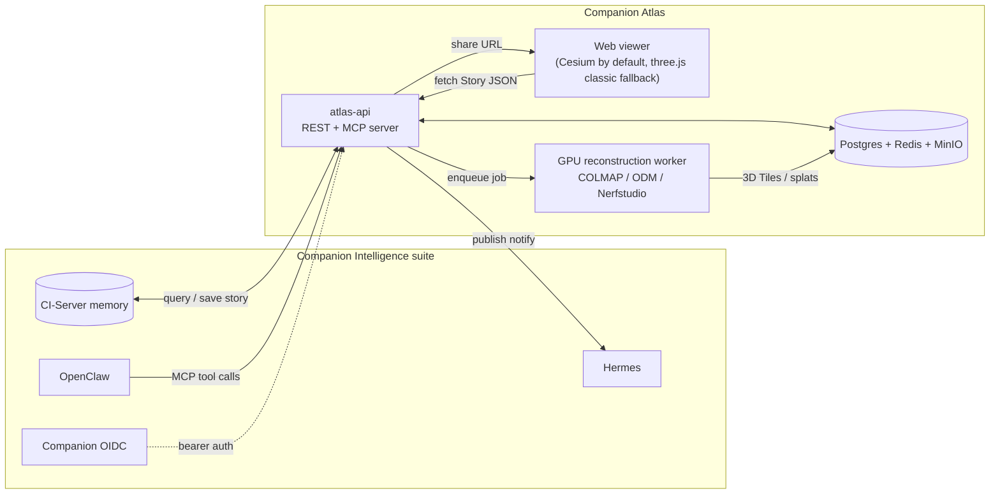

Today's repo ships the **Viewer** (`src/`, two renderers — see
[§6](#6-renderer-and-imagery-mode-resolution) and [§11](#11-cesium-renderer))
and the **atlas-api** scaffold (`server/`) — see
[`docker-compose.yml`](../docker-compose.yml) for how all five pieces run
together in containers. `Worker`, `Store`, and the suite connectors are
functional scaffolds (see [§10](#processing-server)); the viewer's `?story=`
mode (below) lets you exercise the `Story` format end to end without any of
that infrastructure running.

## 2. Viewer module map

```mermaid
flowchart TD
    main["main.ts"]
    journeyController["systems/journeyController.ts"]
    inputSystem["systems/inputSystem.ts"]
    scrapbook["scrapbook.ts"]
    atlasStory["atlas/story.ts"]
    atlasSchema["atlas/schema.ts"]

    subgraph Classic["classic renderer"]
        sceneSystem["systems/sceneSystem.ts"]
        scrapbookSystem["systems/scrapbookSystem.ts"]
        cameraControls["systems/cameraControls.ts"]
        xrSystem["systems/xrSystem.ts"]
        tilesSystem["systems/tilesSystem.ts"]
        atmosphereSystem["systems/atmosphereSystem.ts"]
        textureFactory["systems/textureFactory.ts"]
        tileProvider["systems/tileProvider.ts"]
    end

    subgraph CesiumMode["cesium renderer"]
        cesiumApp["cesium/cesiumApp.ts"]
        cesiumScene["cesium/cesiumScene.ts"]
        cesiumScrapbook["cesium/cesiumScrapbook.ts"]
    end

    main --> sceneSystem
    main --> scrapbookSystem
    main --> inputSystem
    main --> atlasStory
    main --> journeyController
    main -. "renderer=cesium" .-> cesiumApp
    cesiumApp --> cesiumScene
    cesiumApp --> cesiumScrapbook
    cesiumApp --> inputSystem
    cesiumApp --> journeyController
    cesiumApp --> atlasStory
    cesiumScrapbook --> scrapbook
    sceneSystem --> cameraControls
    sceneSystem --> xrSystem
    sceneSystem --> tilesSystem
    sceneSystem --> atmosphereSystem
    sceneSystem --> textureFactory
    sceneSystem --> tileProvider
    sceneSystem --> scrapbook
    scrapbookSystem --> scrapbook
    inputSystem --> scrapbook
    textureFactory --> tileProvider
    atlasStory --> atlasSchema
```

`main.ts` is the composition root for the classic renderer: it builds
`sceneSystem` and `scrapbookSystem`, wires DOM elements into `inputSystem`'s
handler callbacks, and owns the 200ms HUD tick loop (journey playback is
`journeyController.ts`, shared with the Cesium path). When
[renderer resolution](#6-renderer-and-imagery-mode-resolution) picks Cesium,
`main.ts` instead delegates the equivalent wiring to `cesium/cesiumApp.ts`,
which reuses the same renderer-agnostic `inputSystem.ts`, `scrapbook.ts`
storage, `atlas/story.ts`, and `journeyController.ts` — only the rendering
layer (`sceneSystem`/`scrapbookSystem` vs `cesiumScene`/`cesiumScrapbook`) is
renderer-specific. No module reaches back into its composition root — data
flows down, callbacks flow up.

## 3. Render loop

Specific to the classic three.js renderer (`sceneSystem.ts`) — Cesium drives
its own internal render loop via `Viewer` + `Clock` (see [§11](#11-cesium-renderer)).

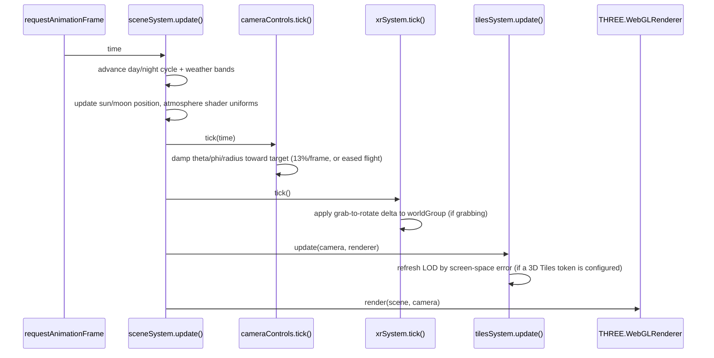

Under `?static=1`, `startLoop()` calls `update()` **exactly once** instead of
registering `renderer.setAnimationLoop` — no day/night drift, no camera
damping beyond a single 13% step, which is what makes Playwright screenshots
reproducible.

## 4. Camera interaction model

Specific to the classic renderer's `cameraControls.ts` — Cesium uses its own
native camera controls as-is (orbit/tilt/zoom gestures are similar, but there
is no equivalent hand-rolled state machine; see [§11](#11-cesium-renderer)).

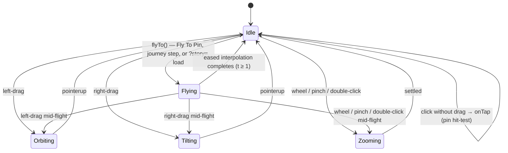

Any of orbit, tilt, or zoom input cancels an in-progress flight — every
`onPointerMove`/`onWheel`/`onDblClick`/pinch handler sets `flight = null`
unconditionally as its first step, not just the orbit-drag path.

`cameraControls.ts` (`src/systems/cameraControls.ts`) is the single owner of
orbit state (`theta`, `phi`, `radius`). Every caller — HUD zoom buttons, Fly To
Pin, journey playback, XR squeeze-to-zoom, story loading — goes through the
same `zoomIn()`/`zoomOut()`/`flyTo()` API, so there is exactly one place that
clamps radius to `[1.15, 14]` and phi to `±0.488π`.

<a id="pin-lifecycle"></a>
## 5. Pin lifecycle

`inputSystem.ts` only forwards DOM events to caller-supplied handler
callbacks — it never imports `sceneSystem`/`scrapbookSystem` directly. The
actual orchestration (raycast → create pin → refresh UI) lives in `main.ts`,
the composition root, matching [§2](#2-viewer-module-map)'s description of how
`main.ts` wires DOM elements into `inputSystem`'s handlers.

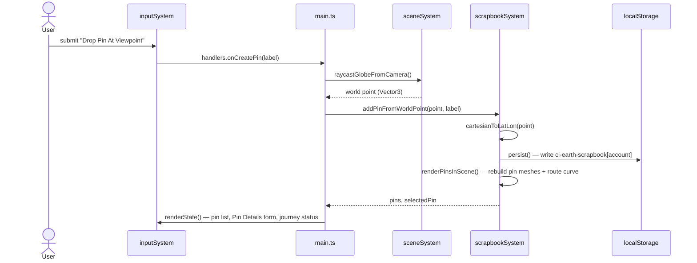

The journey route (`createJourneyRoute` in `scrapbookSystem.ts`) is rebuilt on
**every** pin CRUD operation, not just when a journey is playing — it's a pure
function of the current pin set, sorted by `createdAt`.

The Cesium renderer follows the identical pattern with `cesium/cesiumApp.ts`
standing in for `main.ts` and `cesium/cesiumScene.ts` /
`cesium/cesiumScrapbook.ts` standing in for `sceneSystem`/`scrapbookSystem` —
see [§11](#11-cesium-renderer).

## 6. Renderer and imagery mode resolution

`main.ts` resolves two independent things from the URL on every load: which
**renderer** runs (classic three.js vs Cesium) and, for the classic renderer,
which **imagery mode** it uses.

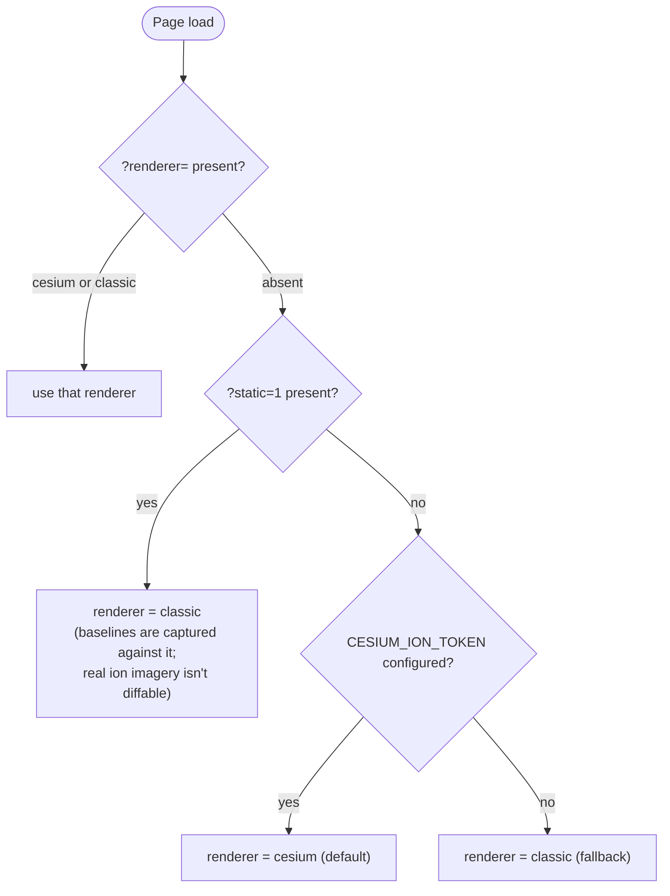

Imagery mode only applies once the classic renderer is selected —
`resolveImageryMode()` checks `?imagery=` **before** `?static=1`, not after:
an explicit `?imagery=` always wins, and `isStaticMode` is only the fallback
when `?imagery=` is absent or invalid.

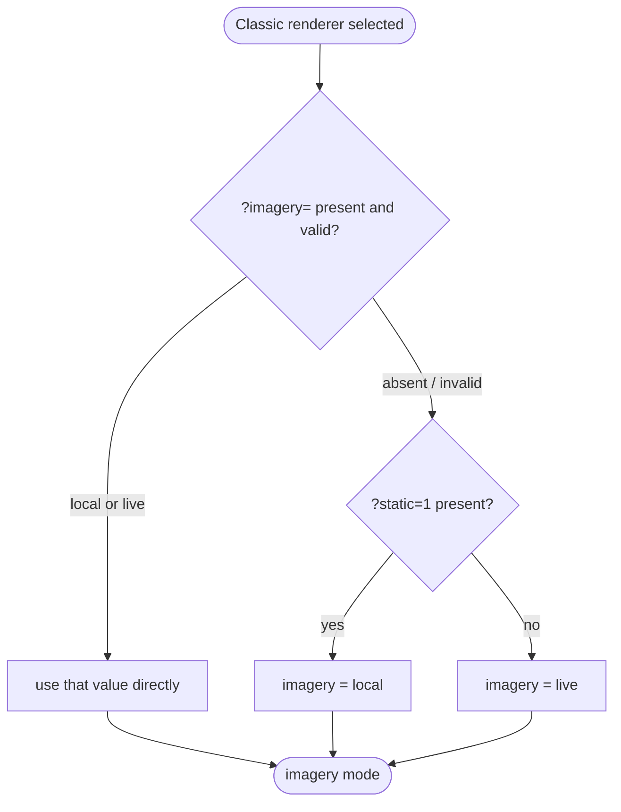

"Local" is **not** zero-network in general — it only skips network tile
fetches under `?static=1`. `imagery=local` on its own still constructs the
hillshade and borders/labels overlay layers (gated solely on `isStaticMode`,
not on imagery mode) and fetches their ESRI tiles over the network; only the
base globe texture is guaranteed local in that case.

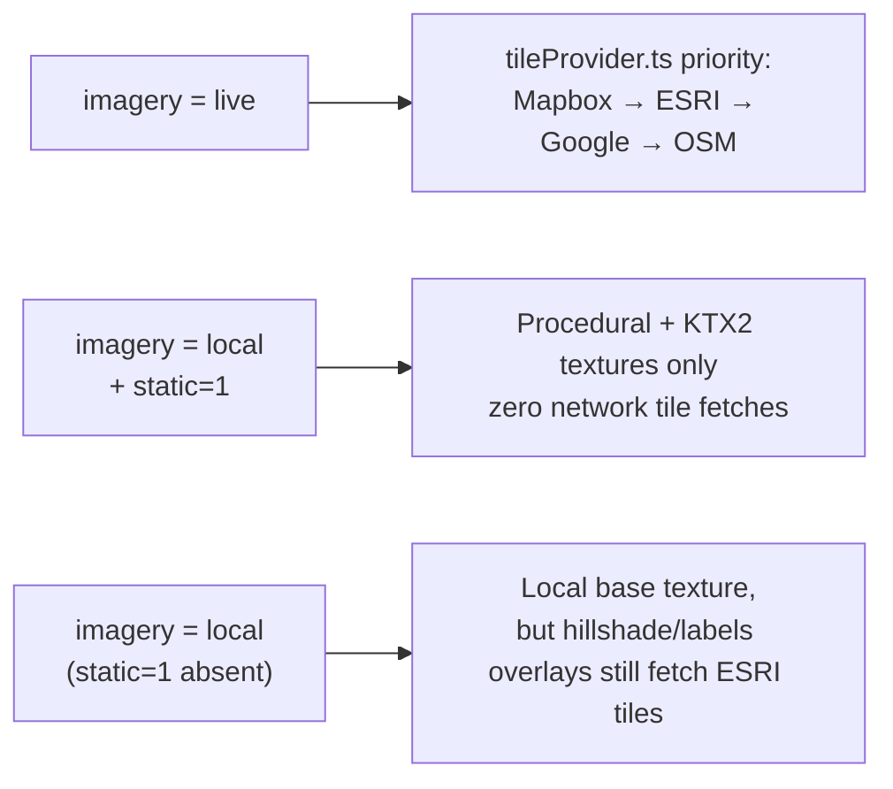

## 7. WebXR interaction

Classic renderer only — Cesium has no WebXR support today, so its XR button
slot instead links back to `?renderer=classic` (see [§11](#11-cesium-renderer)).

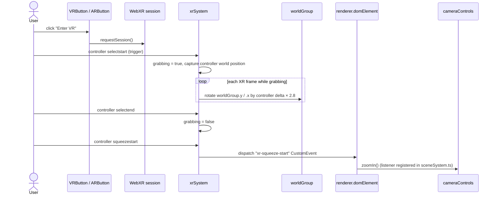

## 8. Texture pipeline

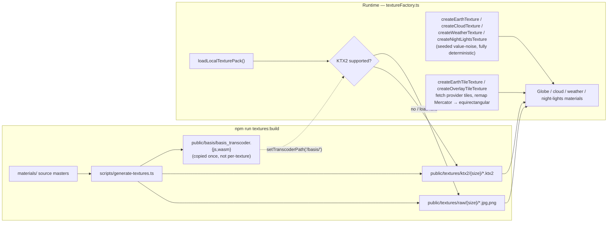

`public/basis/` holds only the two Basis Universal transcoder library files
(`basis_transcoder.js`/`.wasm`, copied once from three.js) — it is the KTX2
**decoder's** location, not where generated textures live. Every individual
generated KTX2 file is under `public/textures/ktx2/{size}/{name}.ktx2`.

The procedural generators (`createEarthTexture`, `createCloudTexture`, etc.)
take a seeded PRNG (`seededRandomFactory`, a linear congruential generator in
`sceneSystem.ts`) so the same seed always produces the same pixels — this is
what makes `?static=1` screenshots byte-for-byte reproducible even without any
texture files on disk.

## 9. The 4D `Story` data model


Defined once as TypeScript in [`src/atlas/schema.ts`](../src/atlas/schema.ts)
(viewer) and mirrored as a runtime-validated Zod schema in
[`server/src/schema.ts`](../server/src/schema.ts) (server) — the two are kept
structurally identical by hand today; a future monorepo would share one
package. [`src/atlas/story.ts`](../src/atlas/story.ts) is the adapter that
projects a `Story`'s scenes onto today's `Pin[]` model so the existing globe
can render it (see [ui-guide.md §7](ui-guide.md#7-story-mode-story)).

<a id="processing-server"></a>
## 10. Processing server

`server/` (package `@companion/atlas-server`) is the **3D processing server +
MCP API**. Full MCP tool reference: [`docs/mcp-api.md`](mcp-api.md). This
section covers the pieces mcp-api.md doesn't: the REST surface, the
ingest→reconstruct→tile pipeline, and the suite connectors.

### 10.1 Auto-compose flow (the "automatic" path)

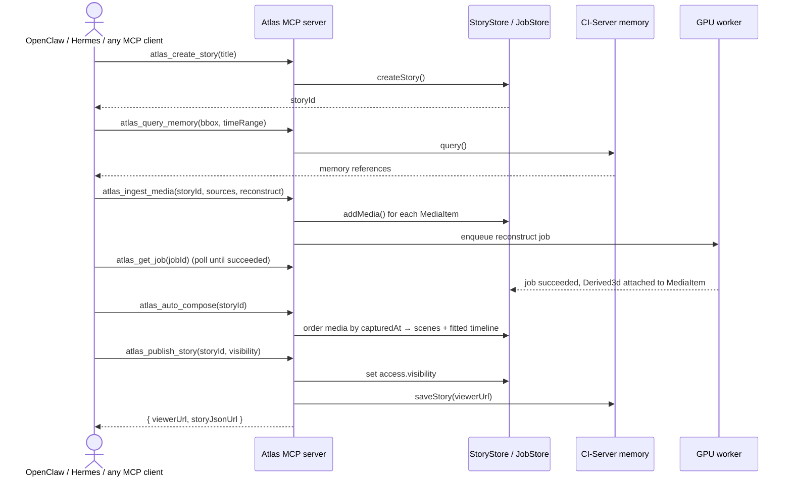

### 10.2 Image/video → 3D pipeline (`server/src/pipeline.ts`)

```mermaid
flowchart LR
    Sources["images / image-set / video<br/>(object-store URLs or ci-memory://)"] --> Ingest
    subgraph Ingest["1. ingest()"]
        direction TB
        Exif["exiftool -json → GPS + capture time"]
        Frames["ffmpeg frame sampling + GPMF/telemetry tracks"]
    end
    Ingest --> MediaItems["MediaItem[]"]
    MediaItems --> Reconstruct
    subgraph Reconstruct["2. reconstruct()"]
        direction TB
        Photo["photogrammetry: COLMAP → OpenMVS / OpenDroneMap"]
        Splat["gaussian-splat: COLMAP poses → Nerfstudio / gsplat"]
    end
    Reconstruct --> Tile
    subgraph Tile["3. tile()"]
        direction TB
        MeshTiles["meshes → py3dtiles / 3d-tiles-tools"]
        SplatTiles["splats → SplatTransform/SOGS → KHR_gaussian_splatting 3D Tiles"]
    end
    Tile --> Derived3d["Derived3d attached to MediaItem<br/>(kind, uri, job)"]
```

Stages 2–3 run in the GPU worker container
([`docker/Dockerfile.worker`](../docker/Dockerfile.worker)); `server/src/pipeline.ts`
only orchestrates — the heavy native tools are not npm dependencies.

### 10.3 REST endpoints (`server/src/api.ts`)

All routes except `GET /healthz` and `GET /api/public/stories/:id` require a
Companion OIDC bearer token once `COMPANION_OIDC_ISSUER` is set (see
[`server/src/auth.ts`](../server/src/auth.ts)); with no issuer configured,
every request runs as a single dev subject.

| Method | Path | Purpose |
|---|---|---|
| `GET` | `/healthz` | Liveness check |
| `GET` | `/api/public/stories/:id` | **Public** — the story JSON the viewer's `?story=` loader fetches |
| `GET` | `/api/stories` | List stories visible to the caller |
| `POST` | `/api/stories` | Create a story |
| `GET` | `/api/stories/:id` | Fetch a story (visibility-checked) |
| `DELETE` | `/api/stories/:id` | Delete a story |
| `POST` | `/api/stories/:id/media` | Ingest media (+ optional `reconstruct` job) |
| `POST` | `/api/stories/:id/scenes` | Append a scene |
| `POST` | `/api/stories/:id/compose` | Auto-sequence located media into scenes |
| `POST` | `/api/stories/:id/publish` | Set visibility, write back to memory, notify OpenClaw/Hermes |
| `GET` | `/api/jobs/:id` | Poll an ingest/reconstruct/tile job |
| `POST` | `/mcp` | MCP over Streamable HTTP (stateless — one server+transport per request) |

### 10.4 Suite connectors (`server/src/connectors.ts`)

| Connector | Env var | Role |
|---|---|---|
| `CiMemoryConnector` | `CI_MEMORY_URL` | Seeds stories from geotagged memories (`query`), resolves `ci-memory://` refs, writes finished stories back (`saveStory`) |
| `OpenClawConnector` | `OPENCLAW_URL` | Notified when a story publishes (`notifyStoryReady`) |
| `HermesConnector` | `HERMES_URL` | Delivers a published story link to a channel/recipient (`deliver`) |

All three are unconditional stubs today regardless of configuration (see
[§13](#13-known-gaps--deliberately-out-of-scope-today)) — the server runs
standalone without the rest of the suite either way.

## 11. Cesium renderer

The default renderer whenever `CESIUM_ION_TOKEN` is configured and
`?static=1` isn't set (see [§6](#6-renderer-and-imagery-mode-resolution)).
Replaces the procedural globe with real Cesium ion World Imagery, World
Terrain, and OSM 3D Buildings — addressing the core "the map doesn't look/work
right" motivation for adding it (see [`REIMAGINE.md`](../REIMAGINE.md)).

| Module | Classic equivalent | Responsibility |
|---|---|---|
| `cesium/cesiumApp.ts` | `main.ts` (classic branch) | Composition root: builds the scene + scrapbook, wires `inputSystem`, HUD tick, journey controller, story loading |
| `cesium/cesiumScene.ts` | `sceneSystem.ts` | Cesium `Viewer` construction, ion resource loading, raycasting, fly-to, layer toggles, environment/heading readouts |
| `cesium/cesiumScrapbook.ts` | `scrapbookSystem.ts` | Pins as Cesium `Entity` billboards (via `PinBuilder`) + a glowing polyline journey route, same `Pin[]`/localStorage data model |

### 11.1 Ion resource loading and offline fallback

Imagery, terrain, and buildings load **independently** — one ion outage
(invalid token, rate limit, restricted network) must not blank out the
others. Imagery additionally falls back to Cesium's bundled offline Natural
Earth II raster (ships in `Assets/Textures/`, zero network required) rather
than leaving zero imagery layers: an empty imagery-layer collection was found
to make `scene.globe.pick()` unreliable, which broke pin creation's
raycast-from-viewport-center entirely whenever ion was unreachable.

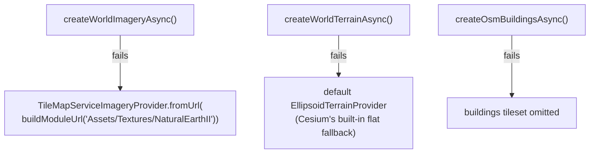

### 11.2 Ion assets used

| Asset | ion ID | Purpose |
|---|---|---|
| Cesium World Imagery | 2 (via `createWorldImageryAsync()`) | Base satellite/aerial imagery |
| Cesium World Terrain | 1 (via `createWorldTerrainAsync()`) | Global elevation mesh |
| Cesium OSM Buildings | 96188 (via `createOsmBuildingsAsync()`) | Global 3D building footprints |

### 11.3 Layer toggle remapping

The sidebar's Layers card checkboxes are repurposed for real Cesium data
rather than the classic renderer's procedural overlays:

| Checkbox | Classic renderer | Cesium renderer |
|---|---|---|
| Terrain Hillshade | ESRI hillshade overlay texture | Real elevation on/off (`terrainProvider` swapped to a flat `EllipsoidTerrainProvider` when unchecked) |
| Borders & Labels | ESRI boundaries/labels overlay texture | OSM 3D Buildings tileset visibility |
| Clouds / Weather | Procedural texture layers | Disabled (`cb.disabled = true`) — no Cesium equivalent shipped yet |

### 11.4 What's genuinely more accurate than the classic renderer

- **Altitude** (`camera.positionCartographic.height`) is real meters above the
  WGS84 ellipsoid, not the classic renderer's `(orbitRadius - globeRadius) ×
  (6371 / globeRadius)` approximation against a 1.24-unit toy globe.
- **Heading/compass** comes directly from `camera.heading`.
- **Sun lighting** (`globe.enableLighting`) is computed from the real system
  clock via Cesium's actual ephemeris, not a scripted day/night cycle.

### 11.5 Deliberate omissions

- **No WebXR.** Cesium has no WebXR support (see [`REIMAGINE.md`](../REIMAGINE.md)
  and the prior `ARCHITECTURE.md` research) — the XR button slot links to
  `?renderer=classic` instead of silently disappearing.
- **No pixel-diff visual regression.** Real ion imagery can change
  server-side independent of this app's code, so `cesium.spec.ts` asserts on
  `data-cesium-status` reaching a terminal state (`ready` or `error`) rather
  than screenshots — see [`docs/ui-guide.md`](ui-guide.md).

## 12. Reference tables

### 12.1 npm scripts — root (`package.json`)

| Script | Command | Purpose |
|---|---|---|
| `dev` | `vite` | Plain Vite dev server |
| `vibe:dev` | `vite --host 127.0.0.1 --port 4173` | Dev server pinned to the port Playwright expects |
| `build` / `vibe:build` | `tsc --noEmit && vite build` | Typecheck + production bundle |
| `preview` | `vite preview` | Serve the production build locally |
| `typecheck` | `tsc --noEmit` | Type-only check |
| `test:visual` / `vibe:test` | `playwright test` | Run the visual regression suite |
| `test:visual:update` / `vibe:test:update` | `playwright test --update-snapshots` | Regenerate baseline screenshots |
| `vibe:loop` | `vibe:build && vibe:test` | Pre-merge gate |
| `textures:build` | `tsx scripts/generate-textures.ts` | Regenerate `public/textures` + `public/basis` from `materials/` |
| `cesium:assets` | `tsx scripts/copy-cesium-assets.ts` | Copy Cesium's Workers/ThirdParty/Assets/Widgets into `public/cesium/` (gitignored; re-run after a Cesium version bump) |
| `docs:screenshots` | `tsx scripts/capture-doc-screenshots.ts` | Regenerate `docs/screenshots/*.png` (needs `vibe:dev` running) |
| `account:new` | `tsx scripts/new-account.ts` | Write a local `.companion-atlas-account.json` |

### 12.2 npm scripts — server (`server/package.json`)

| Script | Command | Purpose |
|---|---|---|
| `dev` | `tsx watch src/index.ts` | REST API + MCP-over-HTTP on `:8787`, hot-reloading |
| `mcp:stdio` | `tsx src/mcp-stdio.ts` | MCP server over stdio, for local agents |
| `build` | `tsc -p tsconfig.json` | Compile to `dist/` |
| `start` | `node dist/index.js` | Run the compiled server |
| `typecheck` | `tsc -p tsconfig.json --noEmit` | Type-only check |

### 12.3 Environment variables (`.env.default`)

| Group | Variables |
|---|---|
| Viewer base imagery (build-time) | `CESIUM_ION_TOKEN`, `GOOGLE_MAP_PLATFORM`, `MAPBOX_API_KEY`, `ESRI_API_ID`, `ESRI_API_KEY`, `ESRI_API_SECRET` |
| Atlas server URLs | `ATLAS_VIEWER_BASE_URL`, `ATLAS_API_BASE_URL` |
| Infrastructure | `DATABASE_URL`, `REDIS_URL`, `S3_ENDPOINT`, `S3_BUCKET` |
| Suite connectors | `CI_MEMORY_URL`, `OPENCLAW_URL`, `HERMES_URL` |
| Companion OIDC | `COMPANION_OIDC_ISSUER`, `COMPANION_OIDC_AUDIENCE`, `COMPANION_OIDC_CLIENT_ID`, `COMPANION_OIDC_CLIENT_SECRET`, `ATLAS_DEV_SUBJECT` |

`CESIUM_ION_TOKEN` does double duty in the viewer: it's what makes Cesium the
default renderer at all (see [§6](#6-renderer-and-imagery-mode-resolution)),
and separately it's read by the classic renderer's `tilesSystem.ts` to stream
Cesium ion World Terrain into the procedural globe. The classic renderer skips
that entirely under `?static=1` regardless of whether the token is set (see
[§3](#3-render-loop)) — a real token must not make "deterministic" test runs
start making network calls.

### 12.4 Docker Compose services (`docker-compose.yml`)

| Service | Image / build | Purpose | Profile |
|---|---|---|---|
| `viewer` | `Dockerfile` (nginx) | Static web viewer | default |
| `atlas-api` | `server/Dockerfile` | REST + MCP server | default |
| `worker` | `docker/Dockerfile.worker` (CUDA) | GPU reconstruction | `gpu` |
| `minio` | `minio/minio` | S3-compatible object store | default |
| `postgres` | `postgres:16-alpine` | Story/scene/media metadata | default |
| `redis` | `redis:7-alpine` | Job queue | default |

```sh
docker compose up viewer atlas-api minio postgres redis   # app tier
docker compose --profile gpu up worker                     # + reconstruction
```

## 13. Known gaps / deliberately out of scope today

- **Auth does not verify signatures — at all, not just when unconfigured.**
  With `COMPANION_OIDC_ISSUER` unset, the server treats every request as one
  dev subject (`ATLAS_DEV_SUBJECT`), which is intentional for local
  development. But even *with* an issuer configured, `verifyBearer()` in
  `server/src/auth.ts` only base64url-decodes the JWT payload and trusts
  whatever `sub` claim is present — it never checks the signature, issuer, or
  expiry. Any client can forge a token with an arbitrary `sub` and read that
  subject's private stories. The source comments already flag this ("DO NOT
  ship it as-is"; `jose`/`openid-client` are declared as dependencies but
  never imported), but it's worth stating plainly here too: this is not
  production-ready auth in either configuration state.
- **Stores are in-memory.** `server/src/store.ts`'s `InMemoryStore` loses all
  data on restart — see [`REIMAGINE.md` Phase 1](../REIMAGINE.md#8-migration-roadmap)
  for the Postgres/Redis/MinIO migration.
- **The reconstruction pipeline is an orchestration stub.** `ingest()` and
  `reconstruct()` in `server/src/pipeline.ts` return well-typed placeholder
  results; they do not yet shell out to COLMAP/ODM/Nerfstudio. The Dockerfile
  for the worker installs the real toolchain in anticipation of this.
- **Suite connectors are unconditional stubs**, not just no-ops when
  unconfigured — every method on `CiMemoryConnector`, `OpenClawConnector`, and
  `HermesConnector` (`server/src/connectors.ts`) returns immediately with a
  `// TODO` comment regardless of whether its URL is set. Same category of gap
  as the reconstruction pipeline above.
- **The classic three.js renderer is still around, not fully replaced.**
  Cesium ([§11](#11-cesium-renderer)) is now the default live renderer, which
  substantially delivers on `REIMAGINE.md`'s Phase 2 recommendation, but the
  classic renderer remains for `?static=1` (deterministic testing) and
  `?renderer=classic` (WebXR, which Cesium doesn't support) — it was not a
  full replace-and-delete migration.
