# UI Guide — Screens, Panels & Controls

A complete reference for every screen region, panel, and interactive control in
the Companion Atlas viewer (`index.html` + `src/`). Screenshots are generated
by [`scripts/capture-doc-screenshots.ts`](../scripts/capture-doc-screenshots.ts)
— regenerate them after a UI change with:

```sh
npm run vibe:dev              # in one terminal
npm run docs:screenshots      # in another, once the dev server is up
```

All screenshots below use `?static=1&imagery=local` so lighting, weather, and
camera position are deterministic.

## 1. Layout overview


The page is a single CSS grid (`#layout`, `src/style.css`) with two regions:

| Region | Element | Width | Notes |
|---|---|---|---|
| Sidebar | `#control-panel` (`<aside>`) | `minmax(320px, 420px)` | Scrollable; collapses to `0` width via `.collapsed` |
| Viewport | `#viewport` (`<main>`) | `1fr` | Hosts the Three.js canvas (`#app`) and all HUD overlays |

At **≤980px** the grid switches to a single column (sidebar above viewport). At
**≤767px** the sidebar becomes a slide-up bottom sheet (see [§5](#5-responsive-behavior)).

Numbered callouts above: **1** brand header, **2** Layers card, **3** drop-pin
form, **4** Pin Details form, **5** lat/lon readout, **6** zoom controls, **7**
compass, **8** environment bar, **9** sidebar-collapse button.

## 2. Sidebar (`#control-panel`)

The sidebar is a stack of `.card` sections rendered top-to-bottom from
`index.html`. Every form inside it is wired in `src/systems/inputSystem.ts`;
state updates flow back in through `renderState()`, called from
`refreshUI()` in `src/main.ts`.

### 2.1 Brand header

| Element | id/selector | Behavior |
|---|---|---|
| Title | `#control-panel h1` | Static text, currently "Companion Atlas" |
| Collapse button | `#sidebar-close` | Sets `.collapsed` on `#control-panel`; shows `#sidebar-open` |

### 2.2 Environment card

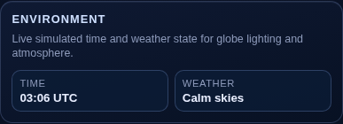

Read-only telemetry, refreshed every 200ms by the HUD tick loop in `main.ts`
and on every `refreshUI()` call.

| Field | Source | Update cadence |
|---|---|---|
| `#env-time` | `sceneSystem.getEnvironmentState().utcTime` — a simulated day/night cycle (`dayCycleMs = 160000`ms per full cycle) seeded from the real UTC hour at page load | Live tick (200ms) + on pin/journey events |
| `#env-weather` | Procedural weather band derived from two overlapping sine waves in `sceneSystem`'s `update()` | Live tick (200ms) |

Under `?static=1` the day fraction is pinned to `0.37` and the weather band to
`0.46`, so this card always reads the same value in tests/screenshots.

### 2.3 Layers card (`#layer-controls`)

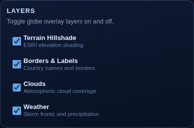

Four checkboxes toggle globe overlay mesh visibility directly
(`sceneSystem.setLayerVisible`, in `src/systems/sceneSystem.ts`). No
persistence — state resets on reload.

| Checkbox id | Layer | Mesh | Source tiles |
|---|---|---|---|
| `#layer-hillshade` | Terrain Hillshade | `hillshadeLayer` | ESRI `Elevation/World_Hillshade` |
| `#layer-labels` | Borders & Labels | `labelsLayer` | ESRI `Reference/World_Boundaries_and_Places` |
| `#layer-clouds` | Clouds | `clouds` | Procedural cloud texture (or KTX2 pack) |
| `#layer-weather` | Weather | `weatherLayer` | Procedural storm-band texture |

Hillshade and labels meshes are only constructed when `!isStaticMode` (see
`sceneSystem.ts`) — in static/test mode their checkboxes exist but there is no
mesh to toggle.

### 2.4 Spatial Scrapbook card

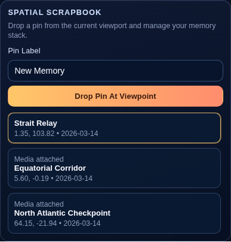

The pin-creation form and the pin list.

| Element | id | Behavior |
|---|---|---|
| Label input | `#pin-label` | Defaults to "New Memory"; trimmed on submit |
| Submit button | inside `#scrapbook-form` | Raycasts from the camera through the screen center onto the globe (`sceneSystem.raycastGlobeFromCamera`) and creates a pin at the hit point |
| Pin list | `#pin-list` | Rendered by `renderPinList()` (`src/scrapbook.ts`); newest pin first; click or `Enter`/`Space` selects a pin |

Creating a pin does **not** require clicking the globe — it always drops at
whatever point is currently centered in the viewport (dead-center raycast),
so panning the globe first, then submitting, is the intended flow.

### 2.5 Pin Details card

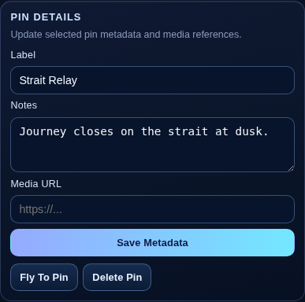

Edits the currently selected pin. Disabled state (no selection) blanks all
fields and disables both action buttons.

| Element | id | Behavior |
|---|---|---|
| Label | `#pin-detail-label` | Free text, max 64 chars |
| Notes | `#pin-detail-notes` | Multi-line textarea |
| Media URL | `#pin-detail-media-url` | Free text; rendered as "Media attached" in the pin list when non-empty |
| Save | submit on `#pin-detail-form` | `scrapbookSystem.updateSelectedPin()` — persists to `localStorage` |
| Fly To Pin | `#pin-fly-btn` | Animates the camera to the pin's lat/lon (`sceneSystem.flyToLatLon`, 1400ms, orbit radius `0.84`) |
| Delete Pin | `#pin-delete-btn` | Removes the pin; selection falls back to the next pin in storage order, or none |

### 2.6 Journeys card

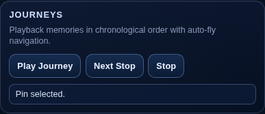

Auto-plays through pins in **chronological `createdAt` order** (not creation
order in the list, which is newest-first).

| Element | id | Behavior |
|---|---|---|
| Play Journey | `#journey-start-btn` | Selects and flies to the first chronological pin immediately, then advances every 2600ms via `window.setInterval` |
| Next Stop | `#journey-next-btn` | Advances one stop without starting the interval loop; wraps to the first pin after the last |
| Stop | `#journey-stop-btn` | Clears the interval; status resets to "Journey idle." |
| Status | `#journey-status` | Free-text status line, e.g. "Journey stop 2/3: Equatorial Corridor" |

The route line itself (the cyan arc connecting pins) is drawn whenever ≥2 pins
exist — it does not require the journey to be playing (see
[`docs/architecture.md`](architecture.md#pin-lifecycle) for the render path).

### 2.7 Account Settings card

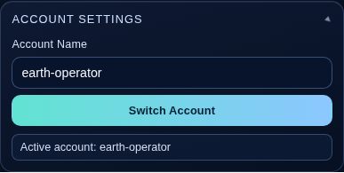

A collapsed `<details class="settings-card">` element (click the summary to
expand — screenshot above is captured in the expanded state).

| Element | id | Behavior |
|---|---|---|
| Account name | `#account-name` | Defaults to `earth-operator` |
| Switch Account | submit on `#account-form` | Loads that account's pins from `localStorage` (key `ci-earth-scrapbook`, scoped by account name), stops any running journey |
| Status | `#account-status` | "Active account: \<name\>" |

Accounts are **not** authenticated — this is a local namespace key, not a login
system. `npm run account:new -- "name"` writes the same name to a local
`.companion-atlas-account.json` file for CLI-driven workflows (see
`scripts/new-account.ts`); it does not affect the browser's `localStorage`.

## 3. Viewport HUD

Overlaid on the 3D canvas (`#app`), all positioned `absolute` within
`#viewport` (see `src/style.css` "Viewport HUD Overlays").

| Element | id | Position | Behavior |
|---|---|---|---|
| Sidebar reopen | `#sidebar-open` | top-left | Hidden by default; shown via JS once the sidebar is collapsed |
| Coordinate readout | `#hud-coords` | bottom-left | Lat/lon under the pointer, updated on `pointermove` over the canvas; blank when the pointer isn't over the globe |
| Zoom controls | `#hud-zoom` (`#zoom-in-btn`, `#zoom-out-btn`) | top-right | Steps camera radius by ×0.78 / ×1.28 |
| Compass | `#hud-compass` | top-right, below zoom | SVG rotated by `-heading` in the 200ms tick loop; heading derives from the camera's orbit angle |
| XR entry buttons | `#hud-xr-buttons` | top-right, below compass | Three.js `VRButton`/`ARButton`; read "not supported" outside a WebXR-capable browser |
| Environment bar | `#env-bar` | bottom-center | Pill showing time · weather · altitude, ticked every 200ms |

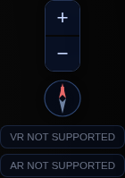

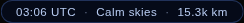

Altitude in the environment bar is derived client-side: `(orbitRadius -
globeRadius) × (6371 / globeRadius)`, formatted as m / km / thousands-of-km
depending on magnitude (`formatAltitude()` in `main.ts`).

## 4. Globe interactions

All pointer/touch/wheel handling lives in `src/systems/cameraControls.ts`; it
owns an orbital camera (`theta`/`phi`/`radius`) around a fixed globe at the
origin.

| Input | Effect |
|---|---|
| Left-click drag | Orbit (rotate `theta`/`phi`); sensitivity scales with current zoom (`radius`) |
| Right-click drag | Tilt only (`phi`), no orbit — mirrors Google Earth's right-drag |
| Scroll wheel | Zoom (`radius × 1.18` out / `× 0.82` in) |
| Two-finger pinch (touch) | Zoom, same clamp range as wheel |
| Double-click | Zoom in 45% (`radius × 0.55`) |
| Click (no drag) on a pin | Selects that pin — same effect as clicking it in the sidebar list |
| Click (no drag) elsewhere | No-op (`onTap` only fires a pin hit-test) |

Camera radius is clamped to `[1.15, 14]` globe-radius units. A programmatic
"flight" (triggered by Fly To Pin, journey playback, or `?story=` loading)
overrides free camera input with an eased interpolation (`smoothstep`,
critically damped at 13%/frame) until it completes or a new drag begins.

## 5. Responsive behavior

| Breakpoint | Layout |
|---|---|
| `> 980px` | Two-column grid: sidebar + viewport side by side |
| `≤ 980px` | Single column: sidebar stacks above a 56vh-tall viewport |
| `≤ 767px` | Sidebar becomes a fixed bottom sheet (62vh tall, slides up/down via `transform: translateY`), starts **collapsed** on load so the globe is unobstructed |


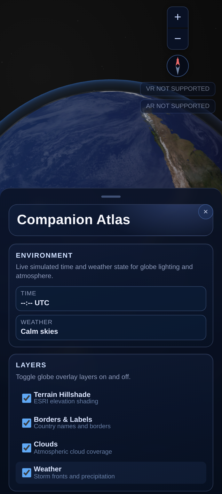
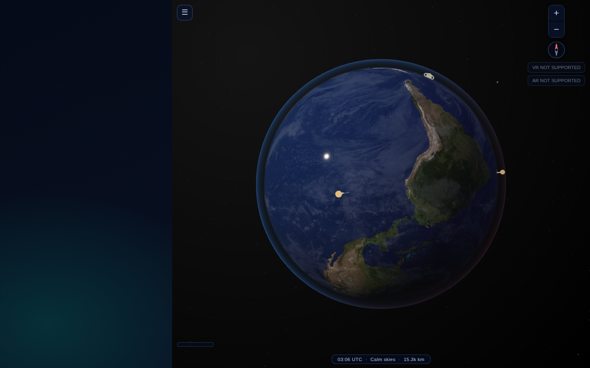

On mobile the collapse/reopen buttons are the same `#sidebar-close` /
`#sidebar-open` elements — CSS media queries reposition `#sidebar-open` to a
centered floating action button at the bottom of the screen.

## 6. Multi-pin & journey state

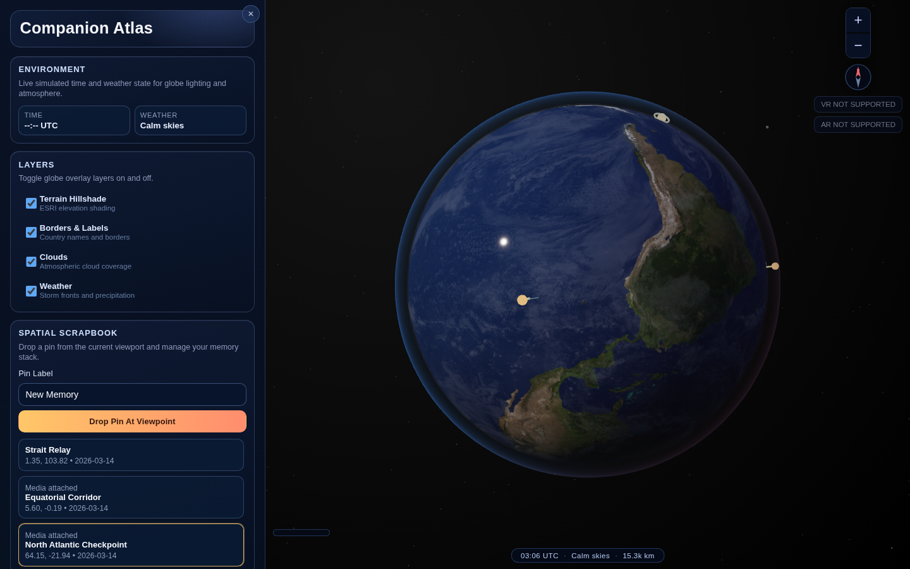
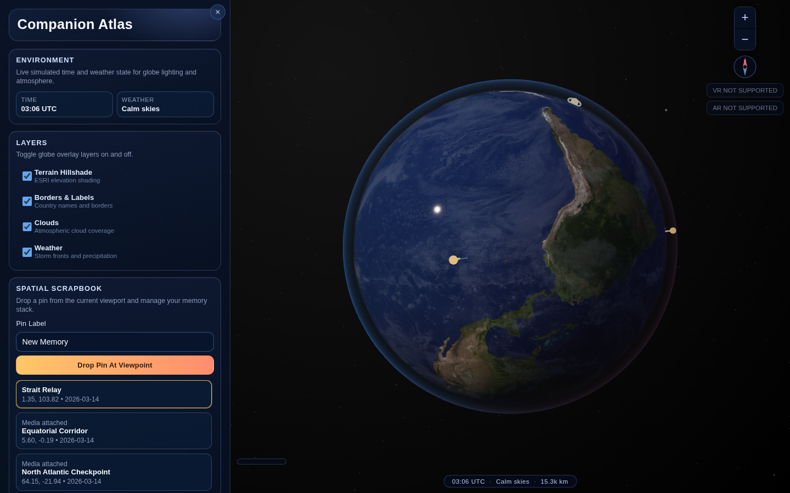

Selecting a pin (from the list or the globe) adds a torus "halo" mesh around
its beacon and enlarges its marker radius (`scrapbookSystem.ts`,
`createPinMarker`). The journey route is a `CatmullRomCurve3` sampled through
every pin in chronological order, rendered as a single `THREE.Line` — it is
recomputed on every pin CRUD operation, not just during playback.

## 7. Story mode (`?story=`)


Passing `?story=<url-to-story.json>` fetches a
[`companion.atlas/story@1`](../src/atlas/schema.ts) document and renders its
scenes as pins, ordered by scene time — a preview of how a published Atlas
story looks before the CesiumJS viewer (Phase 2, see
[`REIMAGINE.md`](../REIMAGINE.md)) lands. It does not touch the signed-in
account's own scrapbook (`scrapbookSystem.loadPins()` is view-only). Try it
locally:

```
/?imagery=local&story=/stories/sample-pacific-journey.json
```

## 8. URL query parameters

| Param | Values | Effect |
|---|---|---|
| `static` | `1` | Freezes the render loop to a single deterministic frame (no day/night cycle, no `requestAnimationFrame` loop) — used by Playwright visual tests |
| `imagery` | `local` \| `live` | Forces local procedural/KTX2 textures vs. live tile providers (Mapbox/ESRI/Google/OSM, see `src/systems/tileProvider.ts`) |
| `story` | a URL to a `Story` JSON document | Loads and renders that story's scenes as a pin journey (§7) |

`static=1` implies `imagery=local` unless `imagery` is explicitly set.

## Known gaps

- `src/workflow.ts`'s `renderWorkflowList()` targets `#workflow-list`, an
  element that does not currently exist in `index.html` — the "vibe loop
  status" list it renders is dead code today (the `getElementById` lookup
  returns `null` and the render call is skipped). Noted here rather than
  silently omitted; harmless, but worth knowing before debugging "why doesn't
  the workflow list show up."
